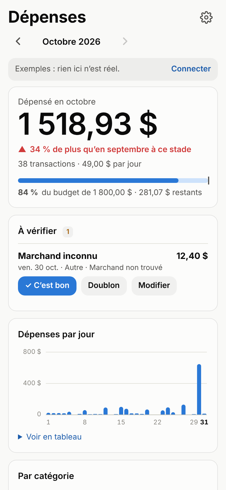
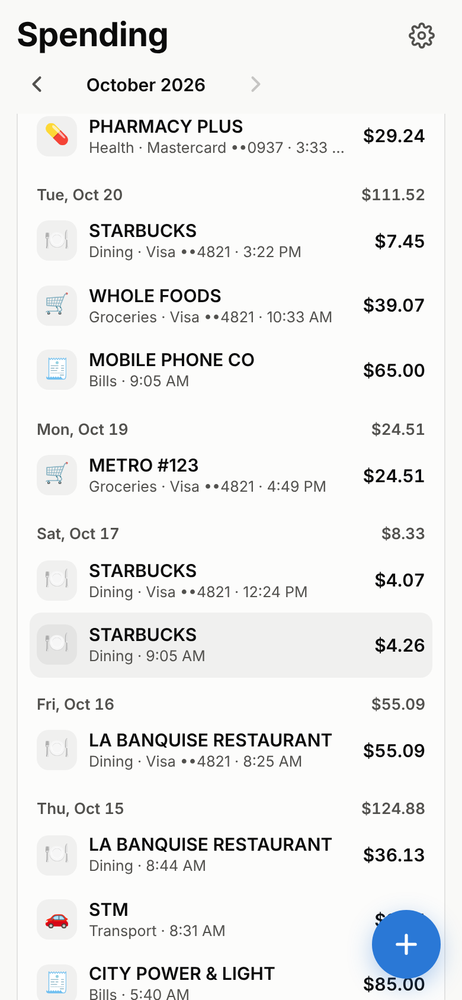
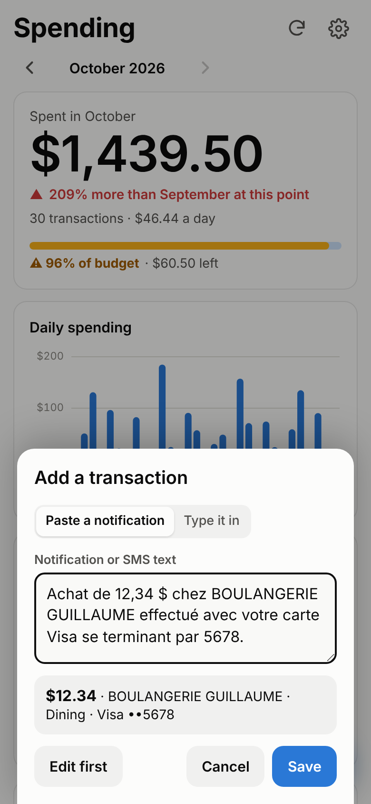

# Spending tracker from bank notifications

Tracks card and bank spending without a bank API. Your phone forwards each bank or credit-card notification to a Google Sheet that you own. A parser turns the text into a transaction, and a one-page dashboard shows where the money goes.

```
 bank / card app notification ─┐
 Apple Pay tap (optional) ──────┼─► iPhone Shortcuts automation ──POST──┐
 bank SMS (optional) ───────────┘   (iOS 27 "Notification" trigger)     │
 Android: MacroDroid / Tasker ───────────────────────────────POST──────┤
                                                                         ▼
                                      Google Apps Script web app (apps-script/Spending.gs)
                                        · SpendParser: amount, currency, merchant, card, type, category
                                        · duplicate check (one purchase seen by two sources)
                                        · Google Sheet tabs: Transactions · Ignored · Rules
                                                                         ▲
                                      Dashboard: index.html (one file, Add to Home Screen)
```

<p>



</p>

- **Try it with sample data:** [open the dashboard](https://jeanculess.github.io/Nassau/depenses.html) and tap *Try it with sample data*.
- **Set it up:** [docs/SETUP.md](docs/SETUP.md). You need a Google account and an iPhone on iOS 27 or later, or an Android phone.

## Why this works on iPhone now

iPhone apps cannot read other apps' notifications. Since iOS 27, Shortcuts can run an automation **when a notification arrives from an app you choose**, and pass its title and text along. That is the capture step. On Android, apps have always been able to read notifications.

## What the parser reads

English and French alert formats, for example:

| Notification | Result |
|---|---|
| `A purchase of $54.21 was made at METRO #123 with your RBC Visa card ending in 1234` | 54.21 · METRO #123 · Groceries · Visa ••1234 |
| `Achat de 54,21 $ chez IGA EXTRA effectué avec votre carte Visa se terminant par 1234.` | 54.21 · IGA EXTRA · Groceries · Visa ••1234 |
| `Paiement CB de 23,90 € chez CARREFOUR CITY le 30/10` | 23.90 EUR · CARREFOUR CITY · Groceries |
| `Your card ending 1234 was used for BSD 45.00 at SOLOMONS FRESH MARKET` | 45.00 BSD · SOLOMONS FRESH MARKET |
| Wallet: title `Visa ••1234`, subtitle `Starbucks`, body `$5.75` | 5.75 · Starbucks · Dining |
| `Purchase of $45.20 at SHELL. Available balance: $1,234.56` | 45.20 (not the balance) · SHELL · Transport |
| `Refund of $25.00 from AMAZON has been credited…` | refund, lowers spending |
| `We've received your payment of $500.00. Thank you!` | transfer, not spending |
| `Your verification code is 482913`, promos, balances, declined, statements, upcoming payments | ignored, listed in the *Ignored* tab |

It understands `$ 1,234.56`, `1 234,56 $`, `1.234,56 €`, and the codes CAD/USD/EUR/GBP/BSD/… whether they come before or after the amount. A low-confidence read is kept but flagged *Check*. Categories come from built-in rules plus your own (the *Rules* tab, editable from the dashboard).

## Files

| Path | What it is |
|---|---|
| `apps-script/Spending.gs` | **The one file to paste into Apps Script** (generated: parser + backend) |
| `src/parser.js` | The parser, shared by the backend and the dashboard |
| `src/backend.gs` | The backend (Google Apps Script web app) |
| `src/dashboard.html` | Dashboard source |
| `index.html` | Generated single-file dashboard (published as `depenses.html` on the `page` branch, served by GitHub Pages) |
| `tools/build.mjs` | Regenerates `apps-script/Spending.gs` and `index.html` |
| `tools/gas-mock.mjs`, `tools/dev-server.mjs` | Local stand-in for Apps Script, used by the tests and for development |
| `test/` | Parser and backend tests (`node --test`), browser test (`test/e2e.mjs`) |

## Develop

```sh
node tools/build.mjs            # after editing src/
node --test test/*.test.mjs     # parser + backend (the real Spending.gs against mocked Google services)
node test/e2e.mjs               # dashboard in Chromium against the local backend (needs Playwright)
node tools/dev-server.mjs       # local dashboard + backend with sample data
```

Status: prototype. The tests cover the parser, the backend and the dashboard. It has not yet been run against a real bank's notifications on an iOS 27 device.
