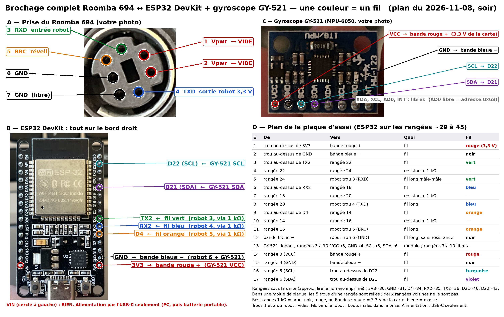
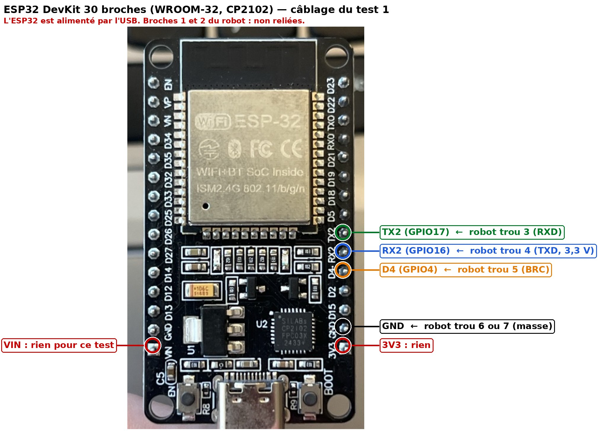

# Code — Roomba 694 piloté par un ESP32

État au 2026-11-09. Sketches Arduino pour un ESP32 classique (ESP32-WROOM, devkit 30 ou 38 broches), compilés avec arduino-cli 1.5.1 et le paquet « esp32 » 3.3.7, téléversés et validés sur le robot : déroulé et mesures dans [journal_tests.md](journal_tests.md). Dernier ajout : le « radar » à ultrasons (HC-SR04 sur servo SG90) du firmware Wi-Fi v3, relu, corrigé et compilé le 2026-11-09, mais **pas encore téléversé, câblé ni testé** ([../notes/G_radar_ultrason_servo.md](../notes/G_radar_ultrason_servo.md)).

## Mesures faites sur le robot (multimètre, 2026-11-08)

| Broche Mini-DIN | Rôle | Mesure (par rapport au trou 6) |
|---|---|---|
| 1, 2 | Vpwr, + batterie | 14,66 V hors base (jusqu'à ~21 V sur la base selon iRobot) |
| 3 | RXD, entrée série du robot | 4,98 V au repos (rappel vers 5 V) |
| 4 | TXD, sortie série du robot | **3,30 V** au repos, robot éveillé |
| 5 | BRC, réveil | 4,98 V au repos (rappel vers 5 V) |
| 6, 7 | masse | 0 V entre 6 et 7 |

Conséquence : la sortie du robot est déjà en 3,3 V. Aucun adaptateur de niveau n'est nécessaire.

## Câblage du test 1 (alimentation par USB, sans abaisseur)

| Robot | ESP32 | Remarque |
|---|---|---|
| 4 (TXD) | GPIO16 (RX2) | direct ; 1 kΩ en série conseillé |
| 3 (RXD) | GPIO17 (TX2) | direct ; 1 kΩ en série conseillé |
| 5 (BRC) | GPIO4 | sortie, haute au repos ; impulsion basse = réveil |
| 6 ou 7 (GND) | GND | masse commune obligatoire |
| 1, 2 (Vpwr) | **rien** | ne pas relier pour ce test |

Carte de l'utilisateur (photo du 2026-11-08) : ESP32 DevKit 30 broches, module ESP32-WROOM-32 sans PSRAM, USB-C, CP2102. Sérigraphie : RX2 = GPIO16, TX2 = GPIO17, D4 = GPIO4, trois broches voisines sur le bord droit.

*Image mise à jour le 2026-11-08 (soir) : prise du robot, carte ESP32, gyroscope GY-521 et plan de la plaque d'essai (section plus bas).*

Carte avec PSRAM (ESP32-WROVER) : GPIO16/17 sont pris par la PSRAM, utiliser 25/26 (modifier `PIN_RX`/`PIN_TX`).

Prompt prêt à coller pour la session Claude Code locale qui fera la compilation et le test : [PROMPT_session_locale.md](PROMPT_session_locale.md).

## `roomba694_test1/` — console série

Moniteur série à 115200 bauds, une touche puis Entrée :

- `w` impulsion BRC (réveil), `s` Start → Passive, `f` Safe, `b` batterie et mode OI, `e` pare-chocs/vide/boutons
- `m` 3 notes, `l` LEDs (mode Safe requis), `c` Clean, `h` retour base
- `8` avance, `2` recule, `4` gauche, `6` droite, `5` ou espace stop — chaque ordre s'arrête seul après 1,5 s
- `a` anti-veille (impulsion BRC toutes les 60 s dans `roomba694_test1`, 45 s dans `roomba694_wifi`), `o` Power, `x` Stop OI

Séquence de validation : `w`, `s`, `b` → la tension lue doit être proche de 14,66 V. Puis `f`, `m` (3 notes), `8`/`4`/`6`, et pour finir `s` puis `x`.

Règles :
- robot au sol, hors de sa base, espace dégagé ; ne pas le soulever en mode Safe (roue levée → retour automatique en Passive, c'est voulu) ;
- toujours finir par `s` puis `x` : en Safe/Full le robot ne se recharge pas et ne dort jamais ;
- si le robot part nettoyer après un appui sur CLEAN : `s` puis `f` le stoppent, puis `s`.

## Résistances de protection (facultatives, conseillées pour le montage définitif)

Trois résistances de **1 kΩ** (brun-noir-rouge ; 470 Ω à 2,2 kΩ conviennent), une **en série sur chaque fil de signal**, n'importe où le long du fil :

| Fil | Liaison | Ce que la résistance limite |
|---|---|---|
| bleu | robot 4 (TXD) → RX2 | le courant entrant dans l'ESP32 si le fil touche autre chose que TXD (Vpwr 14,66 V / 1 kΩ ≈ 15 mA au lieu d'un court-circuit) |
| vert | TX2 → robot 3 (RXD) | le courant poussé par l'ESP32 si le pion est dans un mauvais trou |
| orange | D4 → robot 5 (BRC) | idem ; dans le journal du 2026-11-08, D4 a poussé 3,3 V pendant 40 min dans un fil à 0 V, sans dégât mais sans protection |

Rien sur la masse ni sur l'alimentation. 1 kΩ ne gêne pas la liaison à 115200 bauds. La liaison a été validée sans ces résistances ; elles servent d'assurance contre une erreur de câblage, pas au fonctionnement.

## Gyroscope GY-521 (MPU-6050) et plan de la plaque d'essai

Module de l'utilisateur : GY-521 (sérigraphie « HW-123 », 8 broches : VCC, GND, SCL, SDA, XDA, XCL, AD0, INT). Liaison I²C sur les broches par défaut de l'ESP32 : **SDA = D21 (GPIO21), SCL = D22 (GPIO22)**, toujours sur le bord droit de la carte. Alimentation du module en 3,3 V depuis la broche 3V3 de la carte (le module a son propre régulateur et ses résistances de rappel I²C). AD0 laissé libre → adresse I²C 0x68. XDA, XCL, INT : libres.

Plan de montage (version du 2026-11-08, tard le soir, après repositionnement de la plaque **à l'horizontale** sur le robot) : la carte ESP32 est à droite de la plaque, ses broches 3V3 … D23 dans la colonne b du bandeau du haut, **3V3 en rangée 11 et D23 en rangée 25** ; la rangée de trous libres (colonne a) est juste au-dessus des broches. Les composants vont à gauche de la carte, rangées 28 à 48 du bandeau du haut (le ruban adhésif commence vers la rangée 50). Alimentation **uniquement par l'USB-C de la carte**. Les bandes du haut distribuent le 3,3 V (rouge +) et la masse (bleue −) **de la carte**, tout étant branché dans leur segment de droite (rangées ≤ 30). Trous 1, 2 et 7 du robot : vides.

| # | De | Vers | Quoi | Trou du robot |
|---|---|---|---|---|
| 1 | trou libre de **3V3** (r11) | bande rouge +, trou vers r10 | fil | — |
| 2 | trou libre de **GND** (r12) | bande bleue −, trou vers r10 | fil | — |
| 3 | trou libre de **TX2** (r17) | r44 (colonne b) | fil | — |
| 4 | r44 | r46 | résistance 1 kΩ debout, colonne c | — |
| 5 | r46 (colonne d) | prise du robot | fil long, bout mâle | **trou 3** (RXD) |
| 6 | trou libre de **RX2** (r16) | r41 (colonne b) | fil | — |
| 7 | r41 | r43 | résistance 1 kΩ debout, colonne c | — |
| 8 | r43 (colonne d) | prise du robot | fil long | **trou 4** (TXD) |
| 9 | trou libre de **D4** (r15) | r38 (colonne b) | fil | — |
| 10 | r38 | r40 | résistance 1 kΩ debout, colonne c | — |
| 11 | r40 (colonne d) | prise du robot | fil long | **trou 5** (BRC) |
| 12 | bande bleue − (trou vers r20) | prise du robot | fil long, sans résistance | **trou 6** (GND) |
| 13 | module GY-521 sur ses broches, colonne c, rangées 29 à 36 : VCC 29, GND 30, SCL 31, SDA 32 ; XDA, XCL, AD0, INT (33 à 36) libres ; corps à plat vers le canal, puce en haut | | | — |
| 14 | r29 (VCC, colonne b) | bande rouge +, trou vers r27 | fil | — |
| 15 | r30 (GND, colonne b) | bande bleue −, trou vers r28 | fil | — |
| 16 | r31 (SCL, colonne b) | trou libre de **D22** (r24) | fil | — |
| 17 | r32 (SDA, colonne b) | trou libre de **D21** (r21) | fil | — |

Rangées des broches de la carte (colonne b, à lire sur la plaque) : 3V3 11, GND 12, D15 13, D2 14, D4 15, RX2 16, TX2 17, D5 18, D18 19, D19 20, D21 21, RX0 22, TX0 23, D22 24, D23 25. Les bandes sont probablement coupées vers le milieu de la plaque (rangées 31-33 observées sur une photo précédente) : toutes les connexions aux bandes ci-dessus sont dans le même segment (rangées 10 à 28), donc sans risque ; vérifier après mise sous tension 3,3 V entre bande rouge et bande bleue près de la rangée 27. Image du plan sur la photo de la plaque : `../images/plan_sur_photo_plaque.jpg`. Position du module : `../images/gy521_position_sur_plaque.jpg` (module à plat, axe Z vertical).

## Brochage complet au 2026-11-09 (robot, gyroscope, radar à ultrasons)

Vue depuis la carte ESP32, d'après la photo de la plaque du 2026-11-09. **Côté 3V3** = pattes 3V3 … D23, avec un trou libre à côté de chaque patte ; **côté VIN** = pattes VIN … EN, **sans aucun trou libre** (la carte va jusqu'au bord de la zone de trous). Chaque côté a ses deux lignes d'alimentation (rouge et bleue). Les numéros de rangée dépendent de la position de la carte sur la plaque (3V3 en rangée 11 sur le plan du 2026-11-08 ; sur la photo du 2026-11-09, 3V3 et VIN en rangée 16, D23 et EN en rangée 30) : se repérer aux étiquettes imprimées sur la carte. Le radar (en gras) est **préparé, pas encore câblé** ; son dessin sur la photo réelle : [`../images/branchement_radar_sur_photo.jpg`](../images/branchement_radar_sur_photo.jpg). Les deux anciens schémas `plan_radar_ultrason_plaque*.png`, qui supposaient des trous libres du côté VIN, ont été retirés. Explications dans [../notes/G_radar_ultrason_servo.md](../notes/G_radar_ultrason_servo.md).

| Broche ESP32 | Côté | Relié à | Remarque |
|---|---|---|---|
| 3V3 | 3V3 | ligne rouge du côté 3V3 → GY-521 VCC | 3,3 V du régulateur de la carte ; rien d'autre dessus |
| GND (côté 3V3) | 3V3 | ligne bleue du côté 3V3 → GY-521 GND, robot trou 6, **et ligne bleue du côté VIN (masse du radar)** | masse commune |
| D4 (GPIO4) | 3V3 | 1 kΩ → robot trou 5 (BRC) | sortie, haute au repos ; impulsion basse = réveil |
| RX2 (GPIO16) | 3V3 | 1 kΩ → robot trou 4 (TXD, 3,3 V) | entrée série depuis le robot |
| TX2 (GPIO17) | 3V3 | 1 kΩ → robot trou 3 (RXD) | sortie série vers le robot |
| D21 (GPIO21) | 3V3 | GY-521 SDA | I²C, 400 kHz |
| D22 (GPIO22) | 3V3 | GY-521 SCL | I²C |
| **D18 (GPIO18)** | 3V3 | **servo SG90, fil orange** | PWM 50 Hz, 500 à 2500 µs |
| **D19 (GPIO19)** | 3V3 | **HC-SR04 Trig** | impulsion de 10 µs, 3,3 V suffisent |
| **D23 (GPIO23)** | 3V3 | **rangée 40 de la zone vide, entre les deux résistances : Echo → 1 kΩ → D23, et 2 kΩ de D23 vers la masse** | 3,3 V max : jamais l'Echo (5 V) en direct |
| **VIN** | VIN | **fil posé par l'utilisateur → ligne rouge du côté VIN = 5 V des modules : HC-SR04 Vcc, servo rouge, condensateur +** | environ 4,7 V sur USB (décision du 2026-11-09) ; la patte voisine est GND : aucun contact entre les deux |
| D15, D2, D5, RX0, TX0 | 3V3 | rien | RX0/TX0 = USB ; D2, D5, D15 : broches de démarrage, à éviter |
| GND (côté VIN), D13, D12, D14, D27, D26, D25, D33, D32, D35, D34, VN, VP, EN | VIN | rien d'accessible | pas de trou libre à côté de ces pattes ; D25/D26 (LiDAR) demanderont de déplacer la carte ou une seconde plaque |

| Trou du robot (Mini-DIN 7) | Rôle | Relié à |
|---|---|---|
| 1, 2 | Vpwr, 14 à 21 V | **rien** (plus tard l'entrée de l'abaisseur, note F) |
| 3 | RXD, entrée du robot | 1 kΩ ← TX2 |
| 4 | TXD, sortie du robot (3,3 V) | 1 kΩ → RX2 |
| 5 | BRC, réveil | 1 kΩ ← D4 |
| 6 | masse | ligne bleue du côté 3V3 |
| 7 | masse | rien |

| Module | Broche | Relié à |
|---|---|---|
| GY-521 | VCC, GND, SCL, SDA | ligne rouge du côté 3V3 (3,3 V), ligne bleue du côté 3V3, D22, D21 ; XDA, XCL, AD0, INT libres |
| HC-SR04 | Vcc, Trig, Echo, Gnd | ligne rouge du côté VIN (5 V), D19, 1 kΩ vers D23 (+ 2 kΩ vers la masse), ligne bleue du côté VIN |
| SG90 | brun, rouge, orange | ligne bleue du côté VIN, ligne rouge du côté VIN (5 V), D18 |
| condensateur 100 à 470 µF | +, − | ligne rouge du côté VIN, ligne bleue du côté VIN (patte longue = +) |

La ligne rouge du côté 3V3 (3,3 V) et la ligne rouge du côté VIN (5 V) ne doivent **jamais** être reliées entre elles ; seules les masses (les deux lignes bleues) sont communes.

## Alimentation par le robot (étape suivante, non câblée)

Vpwr (broches 1-2) → abaisseur à découpage **5 V fixe** (CANADUINO 9-35 V → 5 V, 5 A, à borniers, commandé sur Amazon.ca) à travers un interrupteur → ligne rouge du côté VIN de la plaque (5 V du radar à ultrasons, puis du LiDAR), que le fil de l'utilisateur relie déjà à la broche VIN de l'ESP32. Mesurer 5,0 V en sortie **avant** de brancher la carte ; ne jamais brancher l'USB du PC en même temps. Budget du port : 200 mA continus côté batterie (coupure au-delà de 500 mA en crête), soit environ 500 mA sous 5 V après conversion ; chiffrage et références dans [../notes/F_ameliorations_programmation_cartographie.md](../notes/F_ameliorations_programmation_cartographie.md), section 2.1.

## `roomba694_wifi/` — pilotage et mises à jour par Wi-Fi

**Firmware sur la carte au 2026-11-10 : v8** (« v8 Nov 10 2026 15:09:20 » : v6 arrêt sur pare-chocs, v7 lecture du robot 20 fois par seconde, v8 infrarouge et courants des roues à la fin du journal CSV et tour sur place à vitesse réglable, `/api/tour?go=1&v=30`). Même câblage, mêmes touches et mêmes sécurités que `roomba694_test1`, plus le gyroscope GY-521 (MPU-6050) sur D21/D22, et sans câble vers le PC : l'ESP32 peut être alimenté par une batterie portable USB fixée sur le robot. Sept fichiers : `roomba694_wifi.ino` (robot, capteurs, gyroscope, console, Wi-Fi), `carte.ino` (carte des obstacles, depuis la v5), `position.ino` (position du robot, depuis la v4), `radar.ino` (radar à ultrasons HC-SR04 + servo SG90, ajouté en v3), `tour.ino` (tour sur place : le robot tourne sur lui-même en mesurant les distances, ajouté le 2026-11-09), `web.ino` (API et pages servies) et `pages.h` (le HTML des pages, dans un `.h` parce que l'outil Arduino prend le JavaScript des pages pour des fonctions C++ s'il est dans un `.ino`). Déroulé des tests : [journal_wifi.md](journal_wifi.md). Ce que d'autres ont fait avec leurs Roomba (matériel ajouté, programmation, cartographie) et le plan qui en découle : [../notes/F_ameliorations_programmation_cartographie.md](../notes/F_ameliorations_programmation_cartographie.md).

- **Réseau de la carte** : elle crée toujours le Wi-Fi « Roomba694 » (mot de passe par défaut `roomba694`, à changer via `secrets.h`, voir `secrets.example.h`). Connecter le téléphone ou le PC à ce réseau (rester dessus même si l'appareil signale « pas d'internet »), puis ouvrir http://192.168.4.1.
- **Réseau de la maison (option)** : page http://192.168.4.1/wifi : bouton « Chercher les réseaux » (liste des réseaux 2,4 GHz à portée), saisie du mot de passe, enregistrement et connexion immédiate sans redémarrage ; la page affiche l'avancement et, en cas d'échec, la cause (réseau introuvable, mot de passe refusé). Le nom et le mot de passe restent dans la mémoire de la carte, jamais dans le code ni sur la console. La carte garde son propre réseau et répond aussi à l'adresse obtenue sur le réseau de la maison et à http://roomba694.local.
- **Page de pilotage refaite (v5, 2026-11-09)** : sur un téléphone, le premier écran montre la distance mesurée par le capteur, la carte (vue de dessus ou 3D : tracé du robot, obstacles vus, robot et rayon du capteur) et le pavé de pilotage ; batterie, capteurs, réglages, autres commandes et console sont repliés en dessous. Un seul bouton d'état : « Réveiller le robot », « Prendre la main » ou « Fin de session » selon la situation. Thème clair ou sombre selon l'appareil, aucune ressource extérieure. Détail : [journal_wifi.md § 19](journal_wifi.md).
- **Carte des obstacles (v5)** : `carte.ino` place chaque écho du capteur de distance dans la pièce (distance, angle du servo, cap, position du robot) ; `/api/carte` (points [x, y] en mm ; `effacer=1` ; `dx=N` pour le décalage du capteur). `python roomba694_recherche/code/outils/position_capture.py ADRESSE [DOSSIER]` enregistre tracé et obstacles (CSV et dessin).
- **Page web d'avant la v5** (port 80, conçue pour le téléphone ; l'API décrite ici n'a pas changé) : pavé de pilotage « maintenir pour rouler, relâcher pour arrêter » (l'ordre est répété toutes les 400 ms tant que le doigt reste appuyé ; arrêt au relâchement et, de toute façon, 1,5 s après le dernier ordre), curseur de vitesse de 50 à 150 mm/s, boutons réveil / Passive / Safe / Stop OI, batterie (pourcentage, tension, courant, température, état de charge), mode OI décodé, dessin du robot vu de dessus (pare-chocs, 6 signaux « light bumper », 4 capteurs de vide, roues levées), encodeurs, cadran du cap gyroscopique, actions (3 notes, LEDs, anti-veille, CSV, Clean, base, extinction avec confirmation) et console intégrée (les mêmes lignes que la console série, avec envoi d'une touche). API : http://192.168.4.1/api/state (JSON complet), `/api/cmd?c=8` (une touche), `/api/speed?v=100`, `/api/log?since=0` (dernières lignes de la console), `/api/scan` (réseaux à portée).
- **Console TCP** (port 23) : mêmes touches qu'en USB, même sortie. Depuis le PC : `powershell -ExecutionPolicy Bypass -File roomba694_recherche/code/outils/tcp_console.ps1 -HostName 192.168.4.1 -Commands 's','b'`. La sortie va aussi sur l'USB si un câble est branché.
- **Journal CSV** : touche `j` (console ou bouton). Une ligne toutes les 200 ms tant que le robot répond : `csv,ms,enc_g,enc_d,pc_g,pc_d,roue_g,roue_d,vide_g,vide_avg,vide_avd,vide_d,lb_g,lb_avg,lb_cg,lb_cd,lb_avd,lb_d,mv,ma,mode,cap_deg,rot_dps,us_mm` (`us_mm` depuis la v3 : distance devant du radar à ultrasons, −1 inconnue, 0 rien à portée). Pour enregistrer une minute : `tcp_console.ps1 -HostName 192.168.4.1 -Commands 'j' -ListenSeconds 60 -Log parcours.csv`, puis renvoyer `j` pour arrêter.
- **Observation depuis le PC** (carte sur le réseau de la maison) : `python roomba694_recherche/code/outils/monitor_wifi.py 192.168.18.25 1200 1 roomba694_recherche/mesures` lit `/api/state` et `/api/log` chaque seconde pendant 20 min sans rien envoyer au robot, écrit un CSV (batterie, mode, encodeurs, cap, pare-chocs, capteurs…) et un fichier d'événements datés (redémarrages de la carte et leur raison, pare-chocs, épisodes de déplacement avec distance et rotation d'après les encodeurs comparées au gyroscope). Exemple du 2026-11-08 dans `roomba694_recherche/mesures/`. Avec le firmware v3, deux colonnes de plus : `radar_mode` et `us_mm`.
- **Arrêt sur pare-chocs dans le cerveau (v6, 2026-11-10)** : en mode Safe le robot n'arrête pas ses roues quand son pare-chocs touche. Depuis la v6, à chaque lecture des capteurs, pare-chocs enfoncé ou roue levée pendant que les roues tournent : roues arrêtées par le cerveau (au plus 200 ms après le contact). Ensuite l'avance et les rotations sont refusées tant que le pare-chocs est enfoncé, puis tant qu'on n'a ni reculé ni relâché la flèche ; le recul tout droit est toujours accepté. État dans `/api/state`, champ `reflexe`. Vérifié sur un vrai contact : [journal_wifi.md § 22](journal_wifi.md).
- **Sauts pilotés depuis le PC (2026-11-10)** : `code/outils/pilote.py` est un module Python (pas un programme) qui s'utilise pendant qu'`enregistreur.py` tourne : `Pilote(adresse, préfixe_de_l'enregistrement).saut('8', 1.0)` envoie une touche de roues, surveille le journal CSV et arrête au bout de la durée (1,4 s au plus), avec contrôles avant et pendant. Aucun capteur ne regarde derrière : ne reculer que sur le terrain qui vient d'être parcouru.
- **Exploration (2026-11-10)** : `python roomba694_recherche/code/outils/explorer.py --stations 7 --pas 800 --vitesse 75 --tour-v 30 --interdit "x,y,rayon" -- 192.168.18.25 PREFIXE`, pendant qu'`enregistreur.py` tourne : le robot choisit lui-même sa prochaine station dans l'espace libre vu par chaque tour sur place, puis revient par le même chemin. Par défaut il s'arrête devant un sol sombre (tapis) ; `--vide-min 150` le laisse monter dessus. `--reprise FICHIER_stations.json --partir-de 3` reprend une exploration précédente dans le même repère et repart de sa station 3. Détail : [journal_wifi.md § 24 et § 25](journal_wifi.md).
- **Recalage sur les murs (2026-11-10)** : `code/outils/carto.py` est un module Python : la carte par murs en lignes, le recalage d'une station sur les murs connus, la comparaison de deux tours faits au même endroit, l'ajustement d'ensemble. `python "roomba694_recherche/research_notes/Roomba 694 sensor exploitation ideas/data_analysis/i_recalage.py" roomba694_recherche/mesures PREFIXE` l'applique à un fichier `PREFIXE_stations.json` et dessine la carte avant et après. Demande `numpy` et `scipy`. Détail : [journal_wifi.md § 26](journal_wifi.md).
- **Exploration complète (2026-11-10, essayée sur le robot le soir même : [journal_wifi.md § 28](journal_wifi.md))** : `python roomba694_recherche/code/outils/explorer3.py --stations 40 --minutes 45 -- 192.168.18.25 PREFIXE`, pendant qu'`enregistreur.py` tourne, robot réveillé en mode Safe, capteur de distance en mode fixe. Le robot choisit ses stations là où il reste du sol jamais regardé, passe les portes, revient par les trajets déjà faits, corrige sa position en repassant par une station connue et ajuste l'échelle du gyroscope en longeant les murs ; il s'arrête quand il ne reste rien à voir, ou aux limites données. Tapis permis par défaut (`--vide-min 1500` pour s'arrêter devant). Sans robot : `python explorer3.py --simulation appartement -- sim PREFIXE` (mondes de `simulateur.py`), ou `python essai_explorer3.py appartement DOSSIER` pour le bilan et le dessin. Pour voir ce que le programme retiendrait de tours déjà enregistrés : `research_notes/…/data_analysis/j_rejeu_exploration.py`. Détail : [journal_wifi.md § 26](journal_wifi.md).
- **Plan de l'appartement (2026-11-10)** : l'utilisateur a fourni une vue de dessus issue d'un LiDAR. Elle est gardée dans `roomba694_recherche/plan_lidar/`, que le dépôt ignore : c'est une donnée privée, à ne pas pousser sans sa demande. `research_notes/…/data_analysis/k_plan_lidar.py` pose une carte du robot (et un trajet enregistré) sur ce plan et donne l'échelle : 54 pixels par mètre à 5 % près. Détail : [journal_wifi.md § 27](journal_wifi.md).
- **Le robot guidé par le plan (2026-11-10)** : `python roomba694_recherche/code/outils/explorer3.py --plan PLAN.png --px-par-m 53 --depart-plan U,V,CAP [--plan-passe IMAGE] --vide-min 150 -- 192.168.18.25 PREFIXE`. Chaque tour sur place est posé sur le plan (`plan.py`) ; des destinations se donnent pendant que le programme tourne, dans `PREFIXE_CIBLES.json` (`{"serie": n, "cibles": [[u, v], …]}`, pixels du plan), et le robot y va par un chemin tracé au milieu des portes ; sans destination il explore. Arrêt sur place : créer `PREFIXE_ARRET` ; retour au départ : `PREFIXE_RENTRE`. `attendre.py PREFIXE --journal FICHIER --stations N --secondes S` attend le tour suivant ; `suivi_plan.py` dessine un passage sur le plan. Essai sans robot : `essai_explorer3.py MONDE DOSSIER --plan --cibles "x,y;…"`.
- **Où le robot est-il vraiment passé (2026-11-10)** : `research_notes/…/data_analysis/l_localisation_globale.py PLAN.png CAPTEURS.csv DOSSIER NOM "a=FICHIER_stations.json;b=…" [--inverse] [--depart-dans U0,V0,U1,V1] [--n 200000]` pose une suite de passages sur le plan sans rien supposer (filtre à particules : trajet compté par le cerveau, paliers sur le plan, aucun mur traversé) et écrit les positions de tous les tours, le trajet roulé, les tapis et les appuis du pare-chocs. À faire tourner dans les deux sens : s'ils s'accordent, il n'y a qu'une solution.
- **Carte quadrillée (2026-11-10)** : `grille.py` nomme des cases de 50 cm comme aux échecs (lettre de la ligne, A en haut, sans I ni O ; numéro de la colonne, 1 à gauche : « H20 ») ; `carte_grille.py PLAN.png DOSSIER --zones IMAGE --base U,V --global "F1.json;F2.json" --reperes F.json` dessine la vue d'ensemble et trois agrandissements avec ce que le robot a relevé. C'est sur cette carte que l'utilisateur dit d'où part le robot et où il va. Les dessins montrent le plan : ils restent dans `plan_lidar/`.
- **Parcours de station en station (2026-11-10)** : pendant qu'`enregistreur.py` tourne, `python roomba694_recherche/code/outils/parcours_stations.py --vitesse 75 -- 192.168.18.25 PREFIXE "x1,y1;x2,y2;…"` conduit le robot de point en point par sauts (points en millimètres dans le repère de position du cerveau, touche `0` pour le remettre à zéro) et fait un tour sur place à chaque point ; les mesures vont dans `PREFIXE_stations.json`. La carte se calcule ensuite avec `research_notes/Roomba 694 sensor exploitation ideas/data_analysis/h_carte_stations.py`. Premier essai : [journal_wifi.md § 23](journal_wifi.md).
- **Enregistrement d'une séance entière (2026-11-10)** : `python roomba694_recherche/code/outils/enregistreur.py 192.168.18.25 --nom pilotage --duree 900 --csv --e 1` garde la console TCP ouverte et écrit dans `mesures/`, sur l'horloge du PC : toutes les lignes de la console, le journal CSV (lancé et arrêté par l'outil), les réponses à la touche `e` envoyée chaque seconde (infrarouge de la base, courants des moteurs, roulette avant) et `/api/state` deux fois par seconde. Arrêt propre : créer le fichier `…_STOP` dont l'outil affiche le chemin. `--touches "s b e"` envoie des touches au début, `--fin "s x"` à la fin. Détail : [journal_wifi.md § 20](journal_wifi.md).
- **Lecture des capteurs (v4, 2026-11-09)** : toutes les 200 ms par une seule requête, « 142, 100 » : les 80 octets des paquets 7 à 58, réponse complète en 13 à 17 ms sur ce 694 (avant la v4 : liste 149 de 22 paquets, le plus souvent abandonnée pour 22 requêtes par cycle à cause d'un défaut du programme, voir [journal_wifi.md § 18](journal_wifi.md)). Repli prévu sur les groupes 6 puis 101 ; touche `q` pour essayer les trois groupes et afficher les octets reçus. Si le robot ne répond plus (endormi, OI fermée), une tentative toutes les 2 s seulement.
- **Flèches en mode Safe seulement (v4)** : les ordres de roues des flèches ne partent que si le robot est en mode Safe et vient de répondre ; sinon la console affiche « Ordre de roues refusé ». L'ordre d'arrêt part toujours.
- **Position du robot (v4, étape 2 de la cartographie)** : `position.ino` calcule x, y (mm) et le cap (degrés) avec les compteurs des roues et le gyroscope, dans un repère fixé à la remise à zéro (x vers l'avant du robot, y vers sa gauche). Carte « Position » sur la page (tracé, écart au point de départ, bouton de remise à zéro), touche `0` (remise à zéro), touche `k` (compteurs et position), `/api/pose` (position et tracé ; `zero=1`), colonnes `x_mm,y_mm,cap_pos` à la fin du CSV. Essai à faire : un carré piloté à la main doit se refermer. Détail et limites en tête de `position.ino`.
- **Robot qui se réveille ou redémarre (v4)** : le texte qu'il envoie alors (« rtc configured: LSI » sur ce 694) est reconnu, compté et affiché ; touche `v` pour écouter la ligne du robot deux secondes sans rien lui envoyer. `/api/essai?b=...` envoie des octets choisis pour des essais sans mouvement (aucun ordre de roues, de moteurs, de mode ni de débit n'y passe).
- **Gyroscope** : touche `g` (accélérations, vitesses de rotation, axe vertical détecté, cap intégré), touche `z` (recalibration 1 s robot immobile et cap remis à zéro). Le cap est positif vers la gauche (anti-horaire), comme l'angle de l'OI ; une petite zone morte (0,3 °/s) évite la dérive à l'arrêt, mais le cap peut dériver pendant les mouvements : `z` avant chaque mesure.
- **Radar à ultrasons (v3, préparé, relu et corrigé le 2026-11-09, non testé)** : HC-SR04 sur servo SG90 ; servo sur **D18**, Trig sur **D19**, Echo sur **D23** à travers un diviseur 1 kΩ / 2 kΩ, le 5 V des deux modules pris sur la broche VIN par un fil de l'utilisateur jusqu'à la ligne rouge libre du côté VIN de la plaque (décision du 2026-11-09 ; dessin [`../images/branchement_radar_sur_photo.jpg`](../images/branchement_radar_sur_photo.jpg) ; câblage, fixation et plan de test : [../notes/G_radar_ultrason_servo.md](../notes/G_radar_ultrason_servo.md)). Carte « Radar à ultrasons » sur la page : modes arrêt / fixe devant / balayage, dessin polaire (toucher le dessin oriente le capteur), seuil d'arrêt, arrêt auto (roues arrêtées et avance refusée si un obstacle est à moins du seuil devant), « devant en marche avant », sens du servo, pas, amplitude, portée du dessin. Touches `r` (mode suivant) et `u` (état, compteurs et carte en texte). API `/api/radar` (état, carte `points` = [angle, mm, âge], réglages par paramètres `mode`, `angle`, `seuil`, `securite`, `auto`, `pas`, `amplitude`, `ech`, `inv`, `effacer`), résumé `radar` dans `/api/state`. Outil PC : `python roomba694_recherche/code/outils/radar_capture.py 192.168.18.25 120 0.5 roomba694_recherche/mesures` (une ligne CSV par mesure avec encodeurs et cap du moment, dernière carte en SVG).
- **Butée du servo (2026-11-09)** : réglage `butee` (10 à 80°, `/api/radar?butee=N`, liste « butée du servo » sur la page) que ni le balayage, ni le mode fixe, ni le dessin touché ne dépassent ; 30° sur le montage de l'utilisateur, dont les fils du capteur sont courts. Essais du radar sur le matériel : [journal_wifi.md](journal_wifi.md), section 14.
- **Tour sur place (2026-11-09, deux tours réussis le soir même, voir journal_wifi.md § 16 et § 17)** : touche `t` ou `/api/tour?go=1`. Le robot, en mode Safe, tourne sur lui-même vers la gauche à 30 °/s (roues à ±62 mm/s) pendant 380° d'après le gyroscope, capteur de distance droit devant ; chaque mesure est rangée avec le cap du moment (une tous les 3° environ). `/api/tour` renvoie l'état et les mesures `[dixièmes de degré, mm]`, `stop=1` arrête. Refusé si le robot ne répond pas, n'est pas en Safe, a une roue soulevée ou le pare-chocs enfoncé ; arrêt immédiat sur pare-chocs, roue soulevée, robot muet ou sorti du mode Safe, rotation non vue par le gyroscope, capteur sans réaction, durée dépassée, touche d'arrêt ou de roues, mise à jour. Outil PC : `python roomba694_recherche/code/outils/tour_capture.py 192.168.18.25` (lit et dessine le dernier tour : vue de dessus et courbe distance / direction, paliers repérés ; avec `--go`, lance d'abord un tour). Pourquoi ce tour : [../notes/H_cartographie_strategie.md](../notes/H_cartographie_strategie.md).
- **Mises à jour sans câble** :
  1. page http://192.168.4.1/update : envoyer le fichier `.bin` produit par `arduino-cli compile --fqbn esp32:esp32:esp32 --export-binaries roomba694_recherche/code/roomba694_wifi` (il apparaît dans `roomba694_wifi/build/esp32.esp32.esp32/roomba694_wifi.ino.bin`) ;
     **Sans mot de passe depuis le firmware v3 du 2026-11-09** (décision de l'utilisateur : réseau de la maison jugé sûr). La carte accepte tout envoi qui lui est adressé depuis son réseau, sauf ceux venus d'une page d'un autre site : elle vérifie les en-têtes Host et Origin (`updateRequestIsLocal` dans `web.ino`). Tout appareil du réseau de la maison ou du point d'accès peut donc la mettre à jour. Avec le firmware v2, la page demandait l'identifiant `admin` et le mot de passe du point d'accès.
     Depuis le PC, sans navigateur : `curl -F "firmware=@roomba694_recherche/code/roomba694_wifi/build/esp32.esp32.esp32/roomba694_wifi.ino.bin" http://ADRESSE_IP/update` (testé le 2026-11-09 : 1,09 Mo en 10 s, « Mise à jour réussie », la carte redémarre avec la raison « redémarrage logiciel (mise à jour) » et retrouve le réseau de la maison ; un envoi portant un en-tête Origin étranger ou un Host inconnu reçoit 403, sans écriture ni redémarrage) ;
     Par le câble USB, carte branchée sur le PC : `arduino-cli upload -p COM4 --fqbn esp32:esp32:esp32 --input-dir roomba694_recherche/code/roomba694_wifi/build/esp32.esp32.esp32 roomba694_recherche/code/roomba694_wifi` (testé le 2026-11-09 : 12 s ; le réseau de la maison enregistré dans la carte est conservé) ;
  2. ArduinoOTA, carte sur le réseau de la maison : `arduino-cli upload -p ADRESSE_IP --fqbn esp32:esp32:esp32 --upload-field password=roomba694 roomba694_recherche/code/roomba694_wifi`, ou directement `espota.exe -r -i ADRESSE_IP -p 3232 --auth=roomba694 -f …/roomba694_wifi.ino.bin`. Au premier essai : « No response from device », la carte n'a pas pu ouvrir la connexion retour vers le PC (pare-feu Windows à autoriser pour espota) ; la page /update ne pose pas ce problème.
- **Au démarrage de la carte** : deux ordres sont envoyés au robot, arrêt des roues (145, 0, 0, 0, 0) et pause d'un éventuel flux continu de capteurs (150, 0) ; sans effet si le robot dort ou est en Passive. La raison du dernier redémarrage (mise sous tension, mise à jour, baisse de tension, plantage, chien de garde) est affichée au démarrage, par `i`, dans `/api/state` et en bas de la page : utile pour distinguer une alimentation faible (batterie portable, câble) d'un défaut du firmware.
- **Robot allumé mais muet** (aucune réponse, aucun ordre exécuté, alors que les fils sont reliés) : il est peut-être passé à 19200 bauds, ce qui arrive si l'on garde CLEAN appuyé une dizaine de secondes en l'éteignant ou s'il reçoit trois impulsions de réveil. Touche `y` : essai à 19200 bauds, puis retour à 115200 par l'ordre Baud. Le firmware le tente aussi de lui-même quand un Start (`s`) reste sans réponse ou quand les lectures n'ont pas de sens. Vu et réparé le 2026-11-09 : [journal_wifi.md](journal_wifi.md), sections 16 et 17.
- **Touche `p`** : met en pause un flux continu de capteurs (opcode 150) si les lectures deviennent incohérentes (vu une fois : le robot s'était mis à diffuser la liste des 22 paquets toutes les 15 ms). Le firmware l'envoie aussi tout seul après trois lectures périodiques incohérentes.
- **Mises en garde** : la batterie portable doit rester allumée (le Wi-Fi actif, 100 à 250 mA, suffit en général à éviter sa coupure automatique) ; scotcher la carte, la batterie et les fils, car un pion qui sort de la prise pendant un déplacement laisse le robot sur son dernier ordre ; ne pas brancher l'USB du PC et une autre alimentation en même temps ; toujours finir par `s` puis `x`.
