# Piloter un Roomba 694 : quatre voies d'accès

*Synthèse documentaire arrêtée au **2026-11-08**, sans essai sur un robot réel ; mis à jour le même jour avec votre photo de la prise série de votre 694. Étiquettes : **[694 confirmé]** = la source nomme ou montre un Roomba 694 ; **[autre modèle : XXX]** = autre modèle ou famille ; **[non confirmé]** = modèle non précisé, témoignage vague ou inférence (toujours signalée comme telle). Les points susceptibles d'évoluer portent la mention *(état au …)*.*

## Réponse courte : deux vraies interfaces, deux compléments

Un Roomba 694 se commande par **deux interfaces réelles**. Le **port série Open Interface (OI)**, prise Mini-DIN 7 broches cachée sous le capot supérieur, donne tout : démarrage, conduite des roues, capteurs, alimentation d'un petit module [1]. Le **Wi-Fi local** (MQTT sur TLS, port 8883) évite toute ouverture mais se limite aux ordres de haut niveau et à l'état de mission [2, 3]. L'**infrarouge** et la **simulation d'appui sur les boutons** ne servent qu'à démarrer, rentrer ou réveiller le robot [1, 4, 5], sans retour d'état. Point clé : **votre photo du 2026-11-08 montre la prise Mini-DIN 7 broches sur votre 694** [125] **[694 confirmé]**. Aucune photo publiée ne la montrait : on la déduisait des photos d'un 692 dit « physiquement identique » [6, 7] et de deux utilisateurs de 694 faisant tourner le pilote OI create_robot, l'un d'eux disant avoir rebranché « the MDIN » (la prise Mini-DIN) [8]. Selon un propos rapporté, iRobot ne « supporte » pas l'OI sur ses robots Wi-Fi [8]. En Wi-Fi, le robot répond, mais **Home Assistant 2026.11 ne s'y connecte plus** [9] *(état au 2026-11-07)*.

| Voie | Démarrer / arrêter | Piloter les roues | Lire les capteurs | Alimenter un module | Ouverture / soudure | Statut sur 694 | Réf. |
|---|---|---|---|---|---|---|---|
| **Port série OI** (Mini-DIN 7) | Oui | Oui (modes Safe/Full) | Oui (pare-chocs, vide, encodeurs, batterie…) | Oui : batterie brute, 200 mA continus | Déclipser le capot ; pas de soudure si la fiche passe | **[694 confirmé]** : prise vue sur votre robot (votre photo) + deux témoignages publiés ; brochage à vérifier au multimètre | [1, 6, 8, 125] |
| **Wi-Fi local** (MQTT/TLS 8883) | Oui (start, stop, pause, dock, find) | Non | Partiel : batterie, phase, bac, erreurs | Non | Aucune | **[694 confirmé]** | [3, 9] |
| **Infrarouge** (vers le récepteur du robot) | Possible (Clean, Dock, Power) | Grossier (gauche, avant, droite) | Non | Non | Aucune (LED IR) | **[non confirmé]** | [1, 10] |
| **Boutons** (contact en parallèle de CLEAN…) | Oui (Clean, Spot, Dock, réveil) | Non | Non | Non | Ouverture + soudure | **[non confirmé]** | [4, 11] |
| **Alimentation / autres** (batterie, sortie aspiration, debug, radios) | — | — | — | Oui (batterie directe ; sortie aspiration en mission) | Ouverture, souvent soudure | Batterie Li-ion **[694 confirmé]** ; le reste non documenté | [12, 13] |

**Que choisir ?** *[non confirmé — synthèse personnelle des sections suivantes]*
- Conduire le robot ou lire ses capteurs : port série obligatoire, aucune commande de conduite n'étant documentée en Wi-Fi [3, 14].
- Lancer, arrêter, renvoyer à la base : le Wi-Fi local suffit, sans ouvrir le robot [3].
- ESP32-CAM ou Raspberry Pi + caméra : les 200 mA du port ne suffisent pas ; prévoir batterie directe ou alimentation séparée [15].

## 1. Port série OI : la voie complète, présente sur votre robot

### Présence sur le 694 : confirmée par votre photo

| Indice | Statut |
|---|---|
| Votre photo (2026-11-08) : prise Mini-DIN 7 broches (7 trous + détrompeur rectangulaire) visible par un trou rond sous le capot [125] | **[694 confirmé]** (votre robot) |
| iFixit, 692 (guide de 2023) : Mini-DIN soudé sur la carte « R3 MAIN PCB WIFI CD », « (c) 2020 iRobot » [6, 16] | [autre modèle : 692] |
| BestReviews (2024-03-04) : « The Roomba 692 and 694 are physically identical » [7] | [autre modèle : 692 + 694] |
| create_robot #64 : erreur « unknown mode detected » « on 694, running kinetic on Raspberry Pi Zero W » (2021-11-12), « on a 694 w/ a Raspberry PI 3B » (2022-01-15), « It came back on after I plugged the MDIN back in » (même utilisateur, même jour), « never bricked it » [8] | **[694 confirmé]** — témoignages brefs, sans photo ni câblage |
| KieranK07, vérifié le 2026-09-01 : « The 690 speaks the full Open Interface over serial », 9 requêtes capteurs sur 9 [17] | [autre modèle : 690] |
| Support iRobot, relayé le 2022-03-29 : « we don't support the OI spec in the Wi-Fi robots » [8] | [non confirmé] — seconde main |
| ArduRoomba : 500 à 800 « excluding WiFi models », sans justification, ce qui contredit les lignes 690 et 694 [18] | [autre modèle : série 600 générique] |
| ESP32 sur le port d'un 692 : « mine isn't working », cause inconnue [19] | [autre modèle : 692] |

- iFixit ne publie pour le 694 que trois guides (batterie, brosse, filtre) [20] ; le seul projet visant son port n'a encore rien vérifié [21] [694 confirmé].
- Votre photo confirme ce que laissait prévoir le 692 (« physically identical » [7], carte de 2020 [16]) : le port est présent sur votre robot [125] [694 confirmé]. Rien ne prouve que tous les 694 fabriqués l'aient [non confirmé].

### Accès : déclipser le capot (procédure du 692)

- Glisser un outil d'ouverture sous le capot brillant monobloc : « Wedge the side tabs and middle tabs upward to remove the top lid » [6] [autre modèle : 692]. Le guide retire avant pare-chocs et batterie, sans dire si c'est indispensable.
- La prise apparaît par un trou rond du capot intérieur, près d'une pastille orange, vis encore en place [22]. **Inférence [non confirmé]** : aucune vis à retirer si la fiche passe dans le trou.
- **Contradiction sur l'emplacement** : « rear right side, beneath a snap-away plastic guard » selon la spec [23] ; fils partant « from the front of the Roomba » sur le 690 [24] ; prise proche de l'espace « behind the right wheel » sur le 632 [25]. Repérer la prise à l'œil.
- Hauteur de fiche : aucune fiche du commerce ne tenait sous le capot du 690, d'où une fiche plate maison et un JST [24] ; sur un 651, fils pliés par le capot et faux contact soupçonné [26] ; d'autres enfichent des fils fins [27] [autre modèle : 690 ; 651 ; série 600 non précisée].

### Brochage et paramètres série

Référence : la spécification « Create 2 OI … based on the iRobot Roomba 600 », qui ne cite jamais 690, 694 ni le Wi-Fi [1] [autre modèle : Create 2 / « Roomba 600 » générique].

| Broche | Nom | Rôle |
|---|---|---|
| 1, 2 | Vpwr | + batterie non régulé, via fusible réarmable (PTC) 200 mA |
| 3 | RXD | entrée série du robot, 0–5 V |
| 4 | TXD | sortie série du robot, 0–5 V |
| 5 | BRC | Baud Rate Change (sert aussi au réveil) |
| 6, 7 | GND | masse, côté circonférence extérieure |

**Sur votre prise** (géométrie lue sur votre photo, numéros reportés depuis le schéma officiel [1, 125] ; **à vérifier au multimètre**) : trou du haut = 3 (RXD) ; côté gauche, de haut en bas = 5 (BRC), 6 (GND), 7 (GND) ; côté droit, de haut en bas = 1 (Vpwr), 2 (Vpwr) ; en bas à droite = 4 (TXD). Repères : la rangée de trois trous porte 5-6-7, les deux trous dans l'axe du détrompeur rectangulaire sont 3 et 4. La spec place 6 et 7 « towards the outside circumference » [1] ; ce repère n'est pas vérifiable sur la photo [non confirmé].

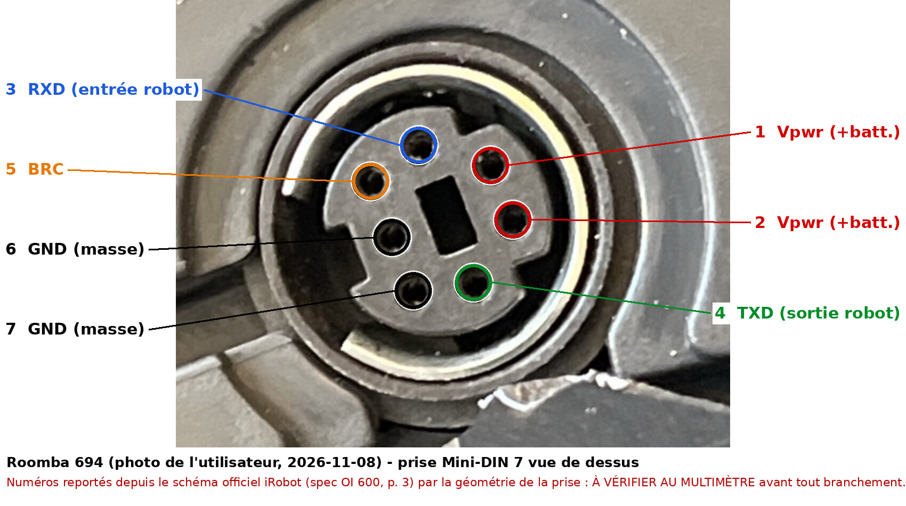
*Roomba 694 — votre prise, numéros reportés depuis la spec OI (p. 3) [1, 125] : à confirmer au multimètre (tension batterie entre 1-2 et 6-7, 0 V entre 6 et 7).*

Procédure pas à pas, à imprimer : [test_multimetre_roomba694.pdf](test_multimetre_roomba694.pdf).

- **115200 bauds, 8N1, sans contrôle de flux** ; 19200 par l'opcode 129, trois impulsions basses sur BRC ou Clean tenu ~10 s à l'extinction, jusqu'à la perte d'alimentation du processeur [1]. iRobot déconseille 115200 sur un AVR à 16 MHz [28] [autre modèle : Create 2].
- **Piège de numérotation** : la note iRobot 3,3 V suit le câble Tensility, « opposite pin numbering convention as Roomba » (3/4 et 5/7 permutés) [29] [autre modèle : Create 2]. Brochages faux publiés : broche 7 « Device Detect » à la masse [30] [non confirmé] ; « +5V (Pin 6) / GND (Pin 1) » sur un 560 [31]. Vérifier Vpwr (1-2) et masse (6-7) au multimètre.

### Ce que la voie permet

| Besoin | Opcodes | Mode requis |
|---|---|---|
| Ouvrir l'OI | Start 128 | → Passive |
| Nettoyer, spot, max, rentrer | 135, 134, 136, Seek Dock 143 | → Passive (charge possible) |
| Arrêter l'OI / éteindre | Stop 173 / Power 133 | → Off / Passive |
| Conduire | Drive 137 (±500 mm/s + rayon), Drive Direct 145 (roue droite d'abord), Drive PWM 146 | Safe 131 ou Full 132 |
| Brosses, aspiration | Motors 138, PWM Motors 144 | Safe/Full |
| Capteurs | Sensors 142, Query List 149, Stream 148 (toutes les 15 ms) | tous |
| Boutons virtuels, sons, LEDs, horaires | 165, 140/141, 139, 167 | variable |

Capteurs : pare-chocs, roues tombées, quatre capteurs de vide, mur virtuel, caractères IR reçus, tension, courant, température et charge batterie, encodeurs, « light bumpers », courants moteurs, mode OI [1] (liste de la spec ; présence matérielle de chaque capteur sur un 694 [non confirmé]). Limites : pas de capteur de surintensité d'aspiration sur la série 600, encodeurs non quadrature, vitesse par pas de ~28,5 mm/s [1]. L'opcode 7 (Reset) fait imprimer la version du firmware [1], mais un 690 n'a rien imprimé [17].

### Contraintes électriques

**Niveaux logiques.** Le TX 3,3 V d'un ESP32, ESP8266 ou Pi attaque RXD directement : « can take a 3.3V input on its RX » [29] [autre modèle : Create 2], vérifié sur un 632 [25] et une carte de 616 [32]. Le sens robot → microcontrôleur est le point délicat :

| Montage sur TXD (broche 4) | Retour | Modèle |
|---|---|---|
| N-FET 2N7000/2N7002 + 2 × 100 kΩ, ou buffer 74LVC245 | recommandé par iRobot ; un diviseur « may not work at high speeds » [29] | [autre modèle : Create 2] |
| Pont diviseur 5 k/10 k ; 2 k/1 k + zener 3,3 V | fonctionne [25, 33, 34] ; échec ailleurs [35] | [autre modèle : 650 ; 632] ; [non confirmé] |
| Transistor PNP 2N3906 | utilisé par plusieurs projets [36, 37] ; « Without transistor ESP is not able to get sensors data » [18] | [autre modèle : 650 ; 600-800 ; 551/605] |
| Convertisseur BSS138 (SparkFun 12009) | **contradictoire** : échec [38], succès [15] | [autre modèle : 650 ; 780] |
| Rien | TXD déjà à 3,3 V au repos sur une carte STM32 [32] | [autre modèle : 616] |

Aucune mesure de TXD n'est publiée pour 690, 692 ou 694. **Inférence [non confirmé]** tirée du cas 616 : mesurer la broche 4 au repos avant de choisir, car un diviseur prévu pour 5 V ramènerait un signal 3,3 V vers ~2,2 V.

**Alimentation (Vpwr).** 200 mA continus et 500 mA en crête, sinon le PTC coupe [1]. Jusqu'à **21 V sur le chargeur** [29] [autre modèle : Create 2] ; relevés : ~13 V (655) [4], 13,9 V à 14 % de charge (690) [17], 15 V puis 20 V en charge (620) [39], ~7,8 V inexpliqués (« 6 series ») [40]. Prendre un abaisseur à découpage à large entrée : MP1584EN [41], Pololu D24V5F5 jusqu'à 36 V [15], UBEC MP2307 5 V/3 A sur 690 [42, 43]. Un LM7833 linéaire chauffe [25] ; un AMS1117, limité à 15 V, « will burn » [39]. Consommations : ESP8266 ~80 à 100 mA [25] ; Pi Zero W + caméra plus de 300 mA, crêtes à 450 mA, fusible déclenché pendant les vidéos [15] [autre modèle : 780]. **Calcul personnel [non confirmé]** : 200 mA sous ~13–14 V, avec un abaisseur à 85 %, donnent au mieux ~0,45 A sous 5 V.

**BRC.** Réveil par impulsion basse : 200 ms puis haute impédance, puis octet 128 [44] ; ~100 ms sur une carte 616 [45]. Contre la veille, les révisions 2015-2016 conseillent une impulsion basse périodique (1 s par minute) [46], la révision 2021 de passer en Safe/Full, qui coupe la charge [1] : **divergence entre révisions iRobot**. Sur la base, le réveil par BRC échoue avant « release-3.8.2/release-stm32-3.7.7 » [1]. **Inférence [non confirmé]** : ces numéros ne se comparent pas sûrement à ceux des robots Wi-Fi (3.2.47 et 3.5.62 relevés sur un 690 [8]), la spec signalant un fork du code après la 3.5 [1] ; le comportement du 694 sur sa base est inconnu.

### Pièges connus

- **Charge coupée** : en Safe/Full, le robot ne dort jamais et ne charge pas, même sur la base ; repasser en Passive (128) ou Off (173) [1]. Mesuré sur un 690 : état de charge 2 → 0, courant de +1232 mA à négatif [17].
- **Mode OI décalé de +1** (paquet 35) : mesuré sur un 690, signalé sur 642, 675 et 694 [8] [694 confirmé pour le symptôme] ; contournements `setModeReportWorkaround()` [47] et `oi_mode_workaround` [48].
- **Sommeil sur la base** : les 650 de 2016 et après ne se réveillent plus par le port série [33] ; parades : relais sur CLEAN [5], LED IR [49], séquence logicielle provoquant des nettoyages nocturnes [50] [autre modèle : 650 surtout]. Un 690 laissé en Passive après un réveil par CLEAN repart nettoyer ; son auteur l'éteint (133) en sortie, car « The robot still charges while powered off » [17].
- **Décharge** : johnboiles met l'ESP en veille sous 10,8 V [44] [autre modèle : 650] ; une batterie vidée en une nuit sur la base est rapportée [35] [non confirmé].
- **Octets parasites** : texte ASCII au réveil (« key-wakeup ») [34] [autre modèle : série 600] ; réponse erronée entre requêtes 142 rapprochées sur un 690, pas avec le flux 148 [17].
- **Bugs firmware** : angle faux jusqu'à la 3.4.0, distance fausse avant la 3.3.0 [1] ; boutons Clock et Schedule inopérants [47].
- **Casse** : TX d'un ESP branché sur Vpwr, « one ESP8266 down » [25] ; « Maybe I killed his Roomba 602's OI port » [51] ; « I fried 2 D1 Mini's » [52]. Un utilisateur retire la batterie avant de câbler [52].
- **Wi-Fi de l'ESP instable quand le robot roule** (632) : l'auteur passe à une alimentation séparée en piles AA [53].

**Matériel type** : câble Mini-DIN 7 (Tensility 10-00543 cité par iRobot [29] ; un câble Apple mini-DIN 8 entre aussi [54] [autre modèle : 880]) ; abaisseur ; PNP ou adaptateur de niveau ; ESP32, ou Pi avec adaptateur USB-série (CP2104 [55], FTDI [56]).

## 2. Wi-Fi local : sans ouverture, sans conduite, fragile en 2026

**Ce qu'elle permet.**
- Le robot héberge un broker **MQTT sur TLS, port 8883** ; identifiant = BLID, mot de passe propre au robot (`:1:<horodatage>:<aléa>`), découverte par broadcast UDP `irobotmcs` sur le port 5678, commandes JSON sur `cmd` [2, 57, 58] [non confirmé — documentation générique].
- Un 694 (« SKU r694020, sw 3.5.18+we+8 ») accepte la connexion (CONNACK en ~48 ms) et publie son état sur `wifistat` et `$aws/things/<BLID>/shadow/update`, **mais n'envoie jamais de SUBACK** [9] [694 confirmé, 2026-11-07].
- Possible : start, stop, pause, resume, dock, find ; batterie, phase, bac, erreurs, statistiques de missions, RSSI [59, 60, 61] [non confirmé pour le 694] ; « start, pause, and dock » sur 694 [3] [694 confirmé].
- Impossible : conduite (« cannot do joystick / WASD driving ») et position ou carte (« 694 does not publish pose or maps ») [3] [694 confirmé] ; aucune alimentation.

**Matériel.** Rien sur le robot. Client : Home Assistant, dorita980/rest980, Roomba980-Python, ou un ESP32 avec `roomba-bridge-esphome`, client ESPHome du broker du robot (aucun modèle testé, patch ESPHome requis pour les gros JSON, dépôt archivé depuis le 2025-01-08) [62] [non confirmé]. Aucun projet ESP8266 trouvé.

**Identifiants (BLID + mot de passe).**
- Local : robot sur sa base et réveillé [2], maintenir HOME (ou HOME+SPOT) ~2 s jusqu'au son, valider dans les 30 s [63]. **Contradiction** : HOME seul (dorita980) [2], HOME ou HOME+SPOT selon le modèle (Home Assistant) [60], DOCK+SPOT sur 675 [2], HOME+SPOT sur un 692 [64] ; rien pour le 694.
- **Piège** : HOME+SPOT tenus 10 s redémarrent un 600 Wi-Fi [65] [autre modèle : série 600 Wi-Fi].
- Sur 694, la récupération locale a échoué dans les deux rapports trouvés (mars 2025 [66] ; « Socket timeout » en novembre 2026 [67]) ; la récupération **depuis le cloud** avec Roomba980-Python a fonctionné le 2025-03-30 [66, 68] [694 confirmé].

**Statut des outils pour le 694** *(état au 2026-11-08)*

| Outil | Statut 694 | Réf. |
|---|---|---|
| Home Assistant (roombapy) | **[694 confirmé]** marchait en mars 2025 ; **échoue depuis HA 2026.11.0 / roombapy 2.0.2** (attente du SUBACK), marchait avec roombapy 1.9.1 (HA 2026.10.3) ; même échec sur un 671 ; issue ouverte | [9, 68, 69, 70] |
| Roomba+ (HACS) | [694 confirmé] « 694, 692 still untested » ; SKU r694020 non reconnu, correctif annoncé en 4.5.3 ; configuration locale en échec | [67, 71] |
| dorita980 / rest980 | cite 690 et 675, pas le 694 [autre modèle : 690, 675] ; version 4.0.0 du 2026-02-27 | [2, 72] |
| homebridge-iRobot | « No » pour un 694 (formulaire de 2022 sans log) [694 confirmé], ce qui contredit le succès HA de 2025 | [73, 74] |
| ioBroker.roomba | 675 et 690 « supported (NO map) » [autre modèle : 675, 690] | [75] |

**Contraintes.** Aucune électrique. TLS ancien : certificats auto-signés, renégociation héritée exigée face à OpenSSL 3 [76] ; une série 600 ne gère pas la renégociation sécurisée RFC 5746 [77] [autre modèle : série 600].

**Pièges.**
- **Une seule connexion locale** : si Home Assistant la tient, l'application passe par le cloud [60]. **Inférence [non confirmé]** : un ESP32 client exclut donc Home Assistant, et inversement.
- **Voyants allumés en permanence** tant qu'une connexion est ouverte, signalé sur un 694 [78] [694 confirmé] ; HA 2026.11 a supprimé les options de connexion intermittente [79] [autre modèle : e5].
- **Mises à jour OTA** : dorita980 conseille de bloquer l'accès Internet du robot [2] ; les OTA n'ont lieu que sur la base, hors nettoyage [80].
- **Firmware** *(état au 2026-11-08)* : dernière note officielle 600/800 = 3.5.62 du 2020-07-15 [81], alors que 692 et 694 annoncent 3.5.18+we+8 en 2025-2026 [9, 64] : incohérence non expliquée.
- **Entreprise** *(état au 2026-11-08)* : iRobot a ouvert un chapter 11 pré-négocié le 2025-12-14, avec « no anticipated disruption to its app functionality » [82] ; Picea détient 100 % d'iRobot depuis le 2026-01-23 [83]. BLID et mot de passe connus, le contrôle local se passe d'Internet [2]. La fiche App Store « iRobot Home (Classic) » ne cite plus la série 600 [84], contrairement à l'aide iRobot [85]. **Inférence [non confirmé]** : noter BLID et mot de passe tant que le cloud répond.

## 3. Infrarouge : démarrer sans ouvrir, sans garantie

**Ce qu'elle permet.** Envoyer les caractères que le robot sait recevoir : télécommande 129 Left, 130 Forward, 131 Right, 132 Spot, 133 Max, 136 Clean, 137 Stop, 138 Power, 143 Seek Dock ; mur virtuel 162 [1] [autre modèle : Create 2 / 600 générique]. La spec ne dit pas lesquels déclenchent une action [1]. **Inférence [non confirmé]** : aucun retour d'état, le lien étant unidirectionnel.

**Matériel et contraintes.** LED IR 940 nm + transistor 2N2222A [86] [non confirmé] ; porteuse ~38 kHz, « 1 » = 3 ms allumé / 1 ms éteint, « 0 » = 1 ms / 3 ms, mesurés sur un 620 [87] [autre modèle : 620] ; octet MSB d'abord [86, 88] [non confirmé] ; IRMP répète 8 trames [88] ; IRremoteESP8266 gère un type « Roomba » [89]. Ligne de vue courte nécessaire [90].

**Statut et pièges.**
- Télécommande officielle 82204 « Compatible with selected 500/600/700/800 », excluant 670, 671, 675 et 677 ; le 694 n'est ni listé ni exclu ; article épuisé [10]. La boîte du 694 ne contient ni télécommande ni mur virtuel [12] [694 confirmé].
- **Résultats contradictoires** sur d'autres 600 : un 620 obéit avec 4 à 5 envois [91] ; un autre utilisateur de 620 trouve Clean = 149, un 621 refuse, un 616 exige 15 répétitions [87] ; un 620 reste sourd [39].
- Le mur virtuel est officiellement pris en charge : Dual Mode Virtual Wall compatible « All Roomba 500, 600… » [92] ; « works flawless » sur un 616 [87].
- Un composant ESPHome envoie le code de démarrage par LED IR quand BRC ne réveille pas le robot en charge d'entretien [90] [non confirmé].

## 4. Boutons : le réveil de dernier recours

**Ce qu'elle permet.** Imiter Clean, Spot ou Dock [11] [autre modèle : séries 500 à 800], et surtout réveiller un robot que BRC ne réveille plus [5] [autre modèle : 650]. Ni conduite, ni capteurs.

**Matériel et contraintes électriques.**
- 655 : CLEAN (SW5) est une paire de pastilles sur le circuit ; « One side is battery voltage (13V) and the other side is usually ground » ; les 3,3 V d'une GPIO de Pi suffisent à le déclencher [4] [autre modèle : 655].
- 560 : transistor NPN reliant la pastille « 13V » à la masse [93] [autre modèle : 560]. **Contradiction** avec le 655 : mesurer avant de câbler.
- Relais isolé 5 V sur les contacts, impulsion de 1 s [11] [autre modèle : séries 500 à 800] ; relais sur CLEAN d'un 650 [94].

**Pièges.** Clean tenu ~10 s à l'extinction fait passer le port à 19200 bauds [1]. En sommeil profond, seul un appui réveillerait le robot (avis d'utilisateur) [95] [autre modèle : 650]. Aucun repérage des pastilles du 694 n'est publié. **Inférence [non confirmé]** : un optocoupleur en parallèle de CLEAN évite d'exposer une GPIO à ~13 V.

## 5. Alimenter un module et autres interfaces

| Option | Ce qu'on obtient | Contraintes | Modèle |
|---|---|---|---|
| Vpwr (port OI) | batterie brute, 200 mA | voir section 1 [1] | [autre modèle : Create 2 / 600 générique] |
| Plots de la batterie | courant non limité par le PTC | adopté par Roomberry après des déclenchements du fusible [15] ; **inférence [non confirmé]** : ajouter un fusible en ligne | [autre modèle : 780] |
| Sortie aspiration (contacts du bac) | 5 V via UBEC + **self de 2,2 mH**, sans laquelle le driver se coupe | active seulement en mission ou via Motors 138 [13], donc en Safe/Full, sans charge [1] | [autre modèle : Create 2] |
| Batterie séparée | indépendance électrique | 12 V + abaisseur [96] (Create 2) ; piles AA pour l'ESP [53] (632) | [autre modèle : Create 2 ; 632] |

- Batterie du 694 : lithium-ion [12], sous le capot inférieur, quatre vis [97] [694 confirmé]. La batterie officielle « 1800 » omet 692 et 694 de sa liste [98], une annonce tierce les inclut [99] : contradiction.
- Debug interne : aucun UART ni SWD documenté ; la carte du 692 montre un STM32F103ZDT6, une empreinte « J5 » non peuplée et des points de test (TP33, TP34, TP35, TP38) [16] [autre modèle : 692] ; la fonction de J5 est inconnue.
- Radios : aucun Bluetooth documenté sur le 694 [12] ; parmi les 600, seuls 610, 611 et 625 ont la radio RF des Lighthouses, 690, 692 et 694 n'étant dans aucune liste [92].
- Cloud et voix : appli iRobot Home, Alexa, Google [12] [694 confirmé] ; IFTTT (Start, Dock, Stop, Pause) [100] [non confirmé] ; le tout dépend des serveurs d'iRobot [101].
- Greffe de carte (ESP32-S3 à la place de la carte iRobot) : modèle jamais nommé [102, 103] [non confirmé]. Module commercial RooWifi sur le port [104] [non confirmé].

## 6. Photos et vidéos : votre 694, puis le 692

Aucune photo ni vidéo publiée d'un 694 ouvert n'a été trouvée ; la seule est la vôtre. Index complet des 37 images : [images/SOURCES.md](images/SOURCES.md).

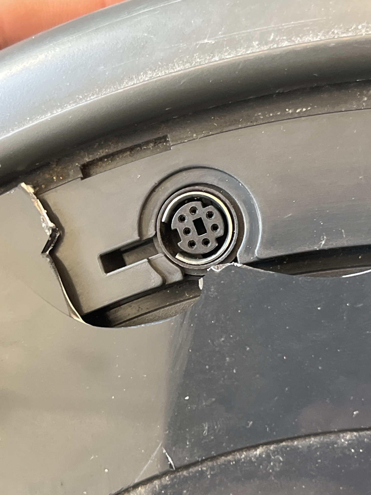
*Roomba 694 — votre photo du 2026-11-08 : prise Mini-DIN 7 broches sous le capot (version annotée en section 1) [125] **[694 confirmé]**.*

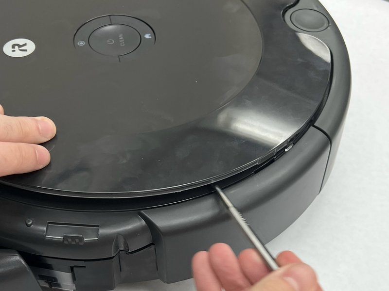
*Roomba 692 — capot supérieur déclipsé à la spatule (iFixit, guide 167779, étape 6) [6].*

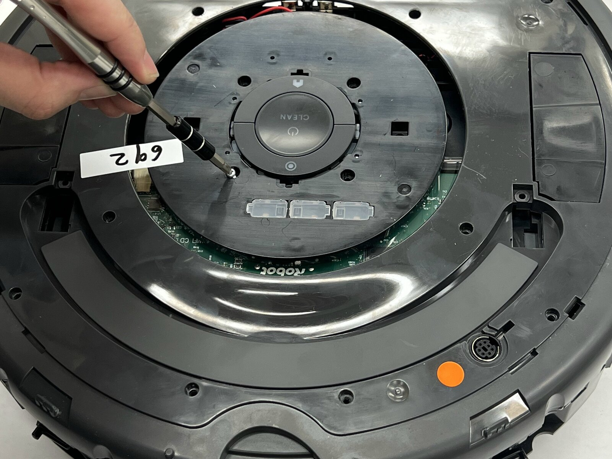
*Roomba 692 (étiquette « 692 ») — capot retiré : prise Mini-DIN visible en bas à droite, près de la pastille orange (iFixit 167779, étape 7) [6].*

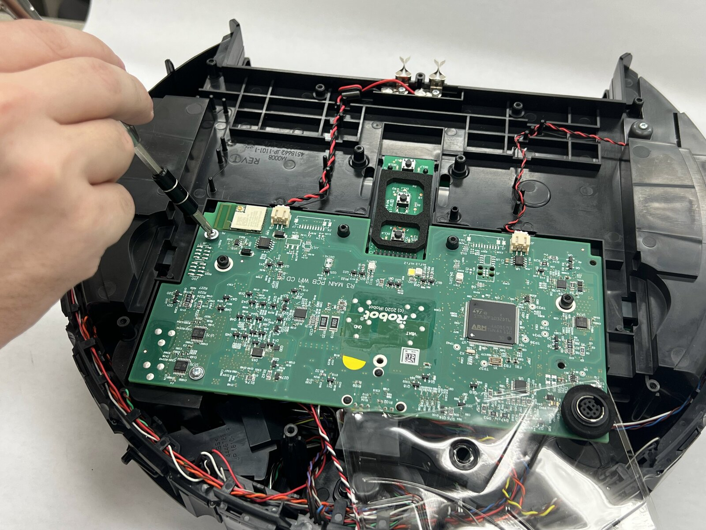
*Roomba 692 — carte mère à nu, Mini-DIN soudé dans un coin (iFixit 167779, étape 8) [6].*

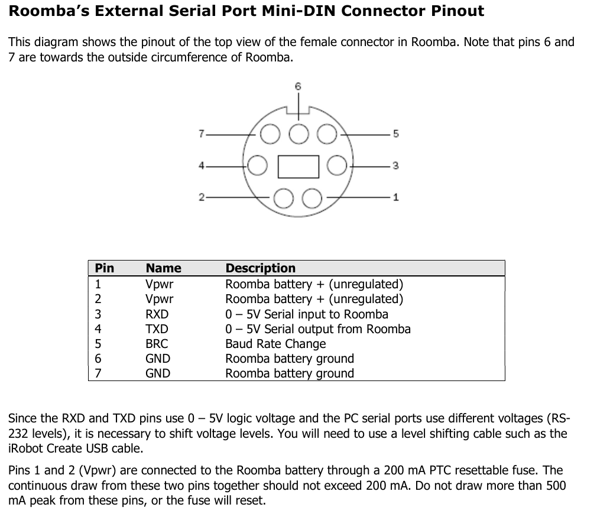
*Brochage, vue de dessus de la prise femelle — document générique Create 2 / « Roomba 600 », aucun 694 nommé (spec OI 2021, p. 3) [1].*

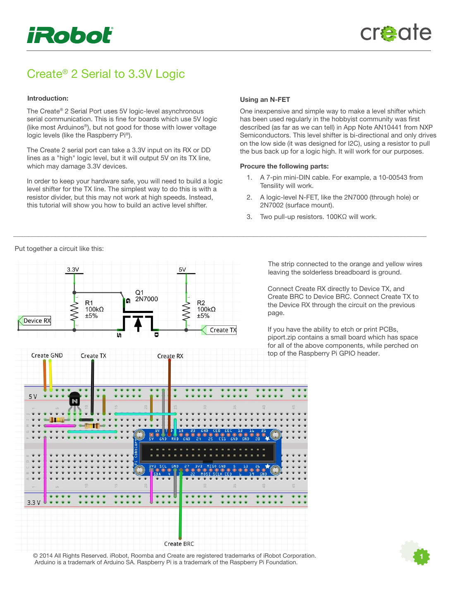
*Adaptateur de niveau N-FET recommandé par iRobot — Create 2 (note « Serial to 3.3V Logic », p. 1) [29].*

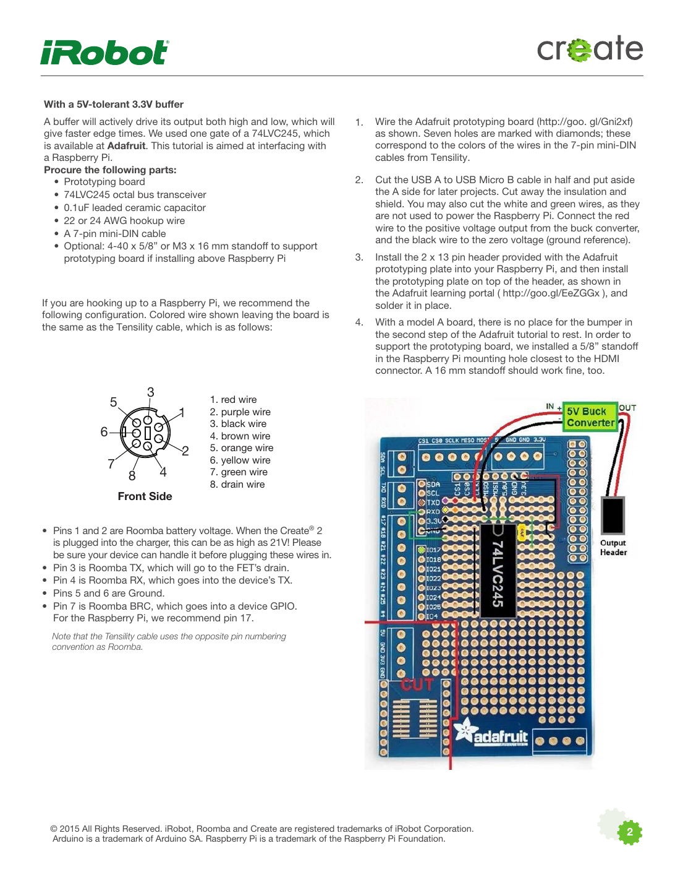
*Même note, p. 2 : numérotation inversée du câble Tensility et « as high as 21V! » — Create 2 [29].*

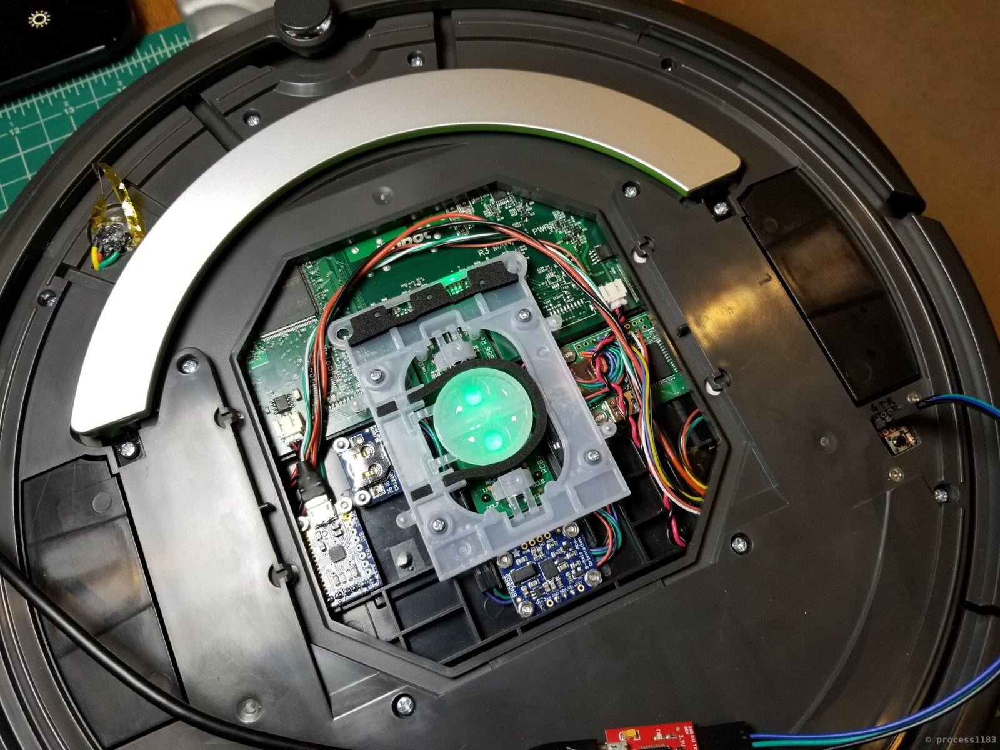
*Roomba 690 — capots partiellement retirés : fiche OI maison (ruban jaune) à gauche, carte série du Raspberry Pi à droite (hackaday.io « Roomba RPi », Build Recap) [24].*

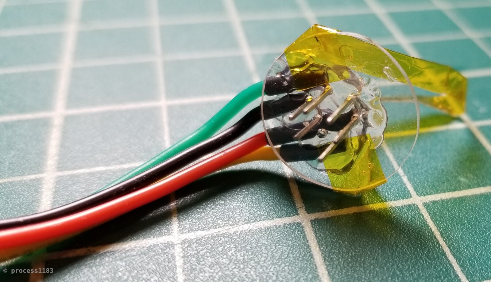
*Fiche « mini-DIN 7 » extra-plate fabriquée pour le 690 (même page) [24].*

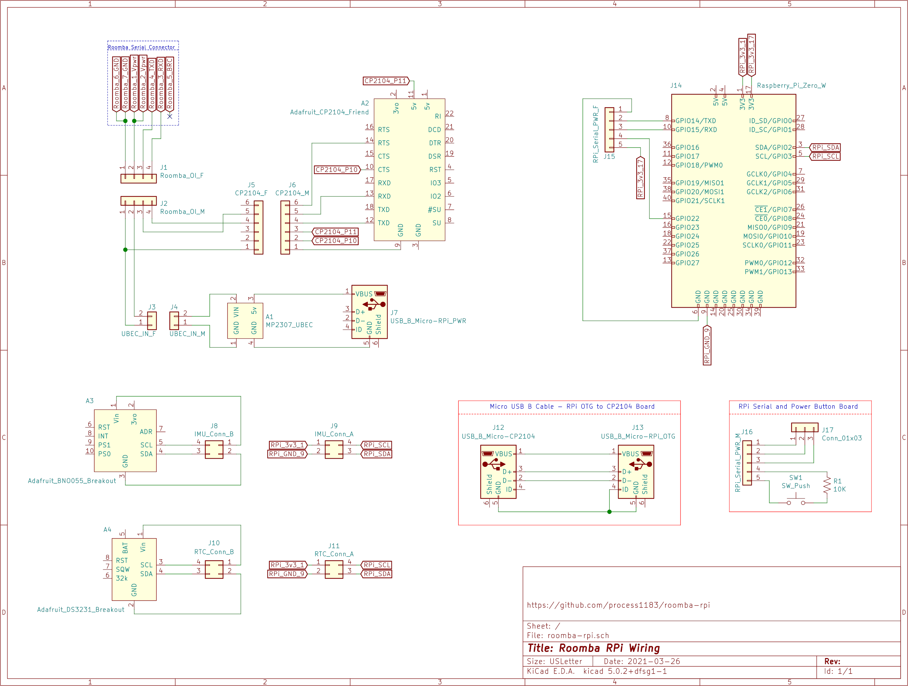
*Schéma du projet sur 690 (modèle non écrit sur le schéma) : Vpwr → UBEC 5 V → Pi Zero, série via CP2104, BRC non connecté (github.com/process1183/roomba-rpi) [55].*

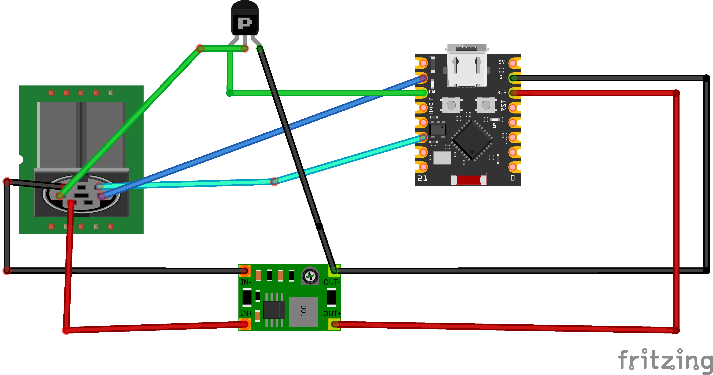
*ESP32-C3 + PNP + mini-abaisseur — aucun modèle sur l'image, projet annoncé « 600/700/800 » ; GPIO BRC du schéma différente du YAML [37, 105].*

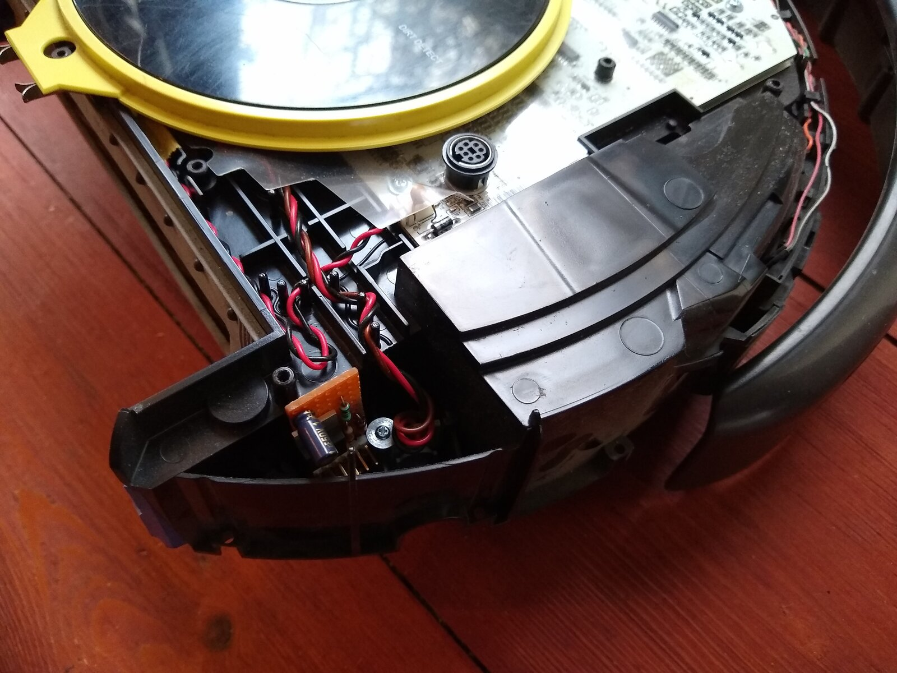
*Roomba 632 — Mini-DIN sur la carte, carte ESP dans la cavité près de la roue (hackaday.io, « Add hardware ») [25].*

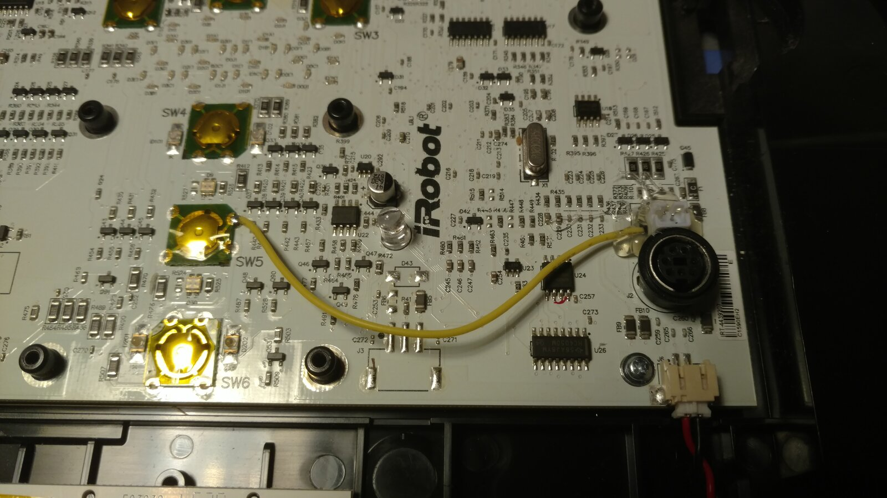
*Roomba 655 — fil soudé sur CLEAN (SW5), relié à un JST collé près du Mini-DIN (Pistreaming Roomba) [4].*

**Vidéos repérées** (titres et chaînes seulement ; aucune n'ouvre un 694, 692 ou 675)

| Titre | Chaîne | Modèle montré | Réf. |
|---|---|---|---|
| How to hack your Roomba | Alizar | inconnu, câblage sur le port [non confirmé] | [106] |
| Roomba 500/600 Series Disassembly | Justin N. | [autre modèle : 500/600 ancien style] | [107] |
| Replacing the Roomba top cover. | MichaelW_CZ | [autre modèle : 500/600 ancien style] | [108] |
| IRobot Roomba How to replace top cover for 500 and 600 series DIY | IRobot Master | [autre modèle : 500/600 ancien style] | [109] |
| What's inside an iRobot Roomba Vacuum?? Complete disassembly video | Gage Fixes Everything | [non confirmé] (670 selon un extrait) | [110] |
| La desmonté ENTERA para descubrir por qué no cargaba \| Roomba paso a paso | No Lo Tires Bro | [non confirmé] (non relevé) | [111] |
| Roomba 694 Full Review & Demo! | Aphid Reviews | [694 confirmé], sans ouverture connue | [112] |
| Roomba 692 vs. 694: Smart Vacuum Face-off! | Vacuum Chef | [694 confirmé] (692 contre 694), sans ouverture connue | [113] |
| Hack Your Old Roomba to a Smart Robotic Vacuum for $5 | The Hook Up | [non confirmé] (« 500 or 600 ») | [114] |
| Roomberry - A Roomba + Raspberry surveillance robot | Dani Macías Perea | [autre modèle : 780] | [115] |
| roomba 765 controlled with Nodemcu esp8266 ESP-12 ESP8266 | Marcel v | [autre modèle : 765] | [116] |
| Create2 Library Demo | Grey | Create 2 / série 600 [non confirmé] | [117] |
| roomba.mp4 | Mike McCauley | [non confirmé] (non identifié) | [118] |
| I made a flamethrowing Roomba! | Alfredo Sequeida | [autre modèle : 770] | [119] |

## 7. Projets existants : beaucoup de 600, aucun 694 publié en série

| Projet | Modèle réellement utilisé | Matériel | Voie et résultat | Réf. |
|---|---|---|---|---|
| Utilisateurs du ticket create_robot #64 (2021-2022) | [694 confirmé] | Pi Zero W, Pi 3B, ROS | série ; bug de mode OI, sans casse | [8] |
| mikey-dev404/roomba-controller (2026) | [694 confirmé] | Mac | Wi-Fi local : start, pause, dock | [3] |
| chrisgawbill/SmarterRoomba (2026) | [694 confirmé] (prévu, non testé) | — | série ; rien de vérifié | [21] |
| KieranK07/roomba-controller (2026-09) | [autre modèle : 690] | câble FTDI depuis un Mac | série : conduite, télémétrie 64 Hz, dock, clean | [56] |
| process1183/roomba-rpi (2021-2022) | [autre modèle : 690] | Pi Zero W puis 2 W, IMU, CP2104, UBEC | série, ROS 2, manette DS4 | [55] |
| Tejeda009/roomba_firmware (2026-09) | [autre modèle : 692] | ESP32 | série : **échec** non expliqué | [19] |
| alphagopher (2018) | [autre modèle : 671] | Pi + câble USB-DIN | série | [120] |
| ShonP40/ESPRoomba (2022 → 2025-12) | [autre modèle : série 600 générique] (« 600/700/800 series » sans numéro) | ESP32-C3, abaisseur 3,3 V, PNP | série, ESPHome ≥ 2025.11, réveil, capteurs | [37] |
| johnboiles/esp-roomba-mqtt (2017-2020) | [autre modèle : 650] | ESP-12E, diviseur, BRC sur GPIO14 | série, MQTT, Home Assistant | [33] |
| thehookup/MQTT-Roomba-ESP01 (2018-2019) | [non confirmé] (« 500 or 600 ») | ESP-01, abaisseur, PNP | série, MQTT | [121] |
| S. Jansen, « Old Roomba, new tricks » (2022-2025) | [autre modèle : 632] | ESP8266 + IMU | série, MQTT/HA, cartographie | [122] |
| jfernandez84/roomba-esp32-oi (2026-11) | [autre modèle : 616] (carte seule, sur banc) | ESP32 | série : roues, encodeurs, flux | [32] |
| mnemocron/esp32-ds4-roomba (2025) | [autre modèle : série 600, numéro inconnu] | ESP32-CAM, caméra inutilisée | série, manette DS4 | [40] |
| ajeanney/esp32-roomba (2025-2026) | [autre modèle : 564] | ESP32-CAM OV5640 | série + vidéo | [123] |
| RobertWojtowicz/rpiroomba (2020-2022) | [autre modèle : 620] | Pi Zero W, caméra NoIR, LED IR, servo | série + vidéo 720p | [41] |
| Pistreaming Roomba | [autre modèle : 655] | Pi 3B + caméra | série + vidéo + fil sur CLEAN | [4] |
| Roomberry (2018-2019) | [autre modèle : 780] | Pi Zero W + caméra, HAT de niveaux | série + instantanés | [15] |

Leçons des projets caméra :
- Aucun projet caméra sur un 69x ; la seule ESP32-CAM qui diffuse de la vidéo roule sur un 564 [123].
- Pi Zero W + caméra : flux lent, remplacé par des instantanés ; crêtes de 450 mA et fusible déclenché, d'où l'alimentation sur les plots de batterie [15] [autre modèle : 780].
- Radiateurs, courant de la LED IR réduit de 700 à 230 mA, adhésif sur la moitié du capteur IR, sans quoi la recherche de la base échoue [41] [autre modèle : 620].
- **Contradiction** : RoomBerry26 situe le Roomberry d'origine sur un 630 [124], le blog d'origine sur un 780 [15].

## Sources

*URL reprises telles qu'elles figurent dans les notes de recherche ; les documents iRobot ont été lus sur des miroirs, les sites officiels étant injoignables pendant la recherche.*

- [1] iRobot, « Create 2 Open Interface (OI) Specification based on the iRobot Roomba 600 », rév. 2021-04-13 (miroir hackaday.io) — <https://cdn.hackaday.io/files/1835247851890816/2021-04-13_iRobot_Roomba_600_Open_Interface_Spec-3.pdf>
- [2] GitHub koalazak/dorita980 (README) — <https://github.com/koalazak/dorita980>
- [3] GitHub mikey-dev404/roomba-controller — <https://github.com/mikey-dev404/roomba-controller>
- [4] yakinikuman, « Pistreaming Roomba » — <https://yakinikuman.github.io/pistreaming_roomba/>
- [5] Forum Home Assistant, « Add wifi to an older roomba », message 141 — <https://community.home-assistant.io/t/add-wifi-to-an-older-roomba/23282/141>
- [6] iFixit, guide 167779 « iRobot Roomba 692 Motherboard Replacement » (2023) — <https://www.ifixit.com/Guide/iRobot+Roomba+692+Motherboard+Replacement/167779>
- [7] BestReviews, « Roomba 692 vs 694 » (J. Gambol, 2024-03-04) — <https://bestreviews.com/articles/home/vacuums/roomba-692-vs-694-which-is-best-for-you>
- [8] GitHub AutonomyLab/create_robot, issue #64 (mode OI, 2021-2022) — <https://github.com/AutonomyLab/create_robot/issues/64>
- [9] pschmitt/roombapy, issue #624 (2026-11-07) — <https://github.com/pschmitt/roombapy/issues/624>
- [10] irobot.fr, accessoire « Infrared Remote for Roomba » (82204) — <https://irobot.fr/fr/roomba-accessories/82204.html>
- [11] Synthiam, « R3 Roomba Control Using 5 Volt Relays » (2014) — <https://synthiam.com/Community/Robots/R3-Roomba-Control-Using-5-Volt-Relays-554>
- [12] irobot.ca, fiche produit Roomba 694 (R694020) — <https://www.irobot.ca/en_CA/roomba-vacuuming-robot-vacuum-irobot-roomba-69-4020/R694020.html>
- [13] Manuel « iRobot DJ Create » (Create 2, miroir manualedistruzioni.it) — <https://manualedistruzioni.it/irobot/robotics/dj-create/user-manual/stle>
- [14] koalazak/dorita980, issue #49 (2017-07-04) — <https://github.com/koalazak/dorita980/issues/49>
- [15] domoticproject.com, « Roomberry: surveillance robot (Roomba + Raspberry Pi Zero W + camera) » — <https://domoticproject.com/roomberry-surveillance-robot-roomba-raspberry-pi-zero-w-camera/>
- [16] iFixit, guide 167779, photo de l'étape 8 — <https://guide-images.cdn.ifixit.com/igi/ZIg521yKc3ndRiZx.full>
- [17] KieranK07/roomba-controller, docs/RESEARCH.md — <https://raw.githubusercontent.com/KieranK07/roomba-controller/main/docs/RESEARCH.md>
- [18] GitHub xthree/ArduRoomba (README) — <https://github.com/xthree/ArduRoomba>
- [19] GitHub Tejeda009/roomba_firmware (README) — <https://github.com/Tejeda009/roomba_firmware>
- [20] iFixit, page appareil « iRobot Roomba 694 » — <https://www.ifixit.com/Device/iRobot_Roomba_694>
- [21] GitHub chrisgawbill/SmarterRoomba, docs/architecture.md — <https://github.com/chrisgawbill/SmarterRoomba/blob/main/docs/architecture.md>
- [22] iFixit, guide 167779, photo de l'étape 7 — <https://guide-images.cdn.ifixit.com/igi/CFNSUZtkgdHAGHho.full>
- [23] iRobot, même spécification, rév. 2015-09-08 (miroir USC) — <https://anrg.usc.edu/ee579/spring2016/Roomba/iRobot_Roomba_600_Open_Interface_Spec.pdf>
- [24] hackaday.io, J. Gadeken, « Roomba RPi », log « Build Recap » (2021-04-08) — <https://hackaday.io/project/178565-roomba-rpi/log/191478-build-recap>
- [25] hackaday.io, S. Jansen, log « Add hardware » (2022-01-22) — <https://hackaday.io/project/183524-controll-yer-roomba-600-series-with-esp8266/log/202540-add-hardware>
- [26] Forum Home Assistant, « Add wifi to an older roomba », message 230 — <https://community.home-assistant.io/t/add-wifi-to-an-older-roomba/23282/230>
- [27] Forum Home Assistant, « Add wifi to an older roomba » (message 1) — <https://community.home-assistant.io/t/add-wifi-to-an-older-roomba/23282>
- [28] iRobot, « Arduino Tutorial » Create 2 (miroir hackaday.io) — <https://cdn.hackaday.io/files/10379444055136/Arduino_Tutorial.pdf>
- [29] iRobot, « Create 2 Serial to 3.3V Logic » (miroir hackaday.io) — <https://cdn.hackaday.io/files/1835247851890816/Create_2_Serial_to_33V_Logic.pdf>
- [30] GitHub loic-skool/Roomba — <https://github.com/loic-skool/Roomba>
- [31] GitHub dynodix/esphome-roomba — <https://github.com/dynodix/esphome-roomba>
- [32] GitHub jfernandez84/roomba-esp32-oi (README) — <https://github.com/jfernandez84/roomba-esp32-oi>
- [33] GitHub johnboiles/esp-roomba-mqtt (README) — <https://github.com/johnboiles/esp-roomba-mqtt>
- [34] hackaday.io, S. Jansen, log « Interfacing » (2022-01-22) — <https://hackaday.io/project/183524-controll-yer-roomba-600-series-with-esp8266/log/202538-interfacing>
- [35] Forum Home Assistant, « Add wifi to an older roomba », export brut p. 2 — <https://community.home-assistant.io/raw/23282?page=2>
- [36] GitHub mannkind/ESPHomeRoombaComponent — <https://github.com/mannkind/ESPHomeRoombaComponent>
- [37] GitHub ShonP40/ESPRoomba — <https://github.com/ShonP40/ESPRoomba>
- [38] Forum Home Assistant, « Add wifi to an older roomba », export brut p. 1 — <https://community.home-assistant.io/raw/23282>
- [39] joric/mystery, README — <https://raw.githubusercontent.com/joric/mystery/master/README.md>
- [40] GitHub mnemocron/esp32-ds4-roomba — <https://github.com/mnemocron/esp32-ds4-roomba>
- [41] GitHub RobertWojtowicz/rpiroomba — <https://github.com/RobertWojtowicz/rpiroomba>
- [42] process1183/roomba-rpi, electrical/parts_list.csv — <https://raw.githubusercontent.com/process1183/roomba-rpi/HEAD/electrical/parts_list.csv>
- [43] process1183/roomba-rpi, schéma electrical/roomba-rpi.png (2021-03-26) — <https://raw.githubusercontent.com/process1183/roomba-rpi/HEAD/electrical/roomba-rpi.png>
- [44] johnboiles/esp-roomba-mqtt, src/main.cpp — <https://github.com/johnboiles/esp-roomba-mqtt/blob/master/src/main.cpp>
- [45] jfernandez84/roomba-esp32-oi, docs/hardware.md — <https://raw.githubusercontent.com/jfernandez84/roomba-esp32-oi/HEAD/docs/hardware.md>
- [46] iRobot, même spécification, rév. 2016-08-10 (miroir GitHub justenstall/robotics-labs) — <https://media.githubusercontent.com/media/justenstall/robotics-labs/c2cfc9f2749b470a6c2bd4e0ce4eae57f893406b/iRobot_Roomba_600_Open_Interface_Spec.pdf>
- [47] GitHub AutonomyLab/libcreate (README) — <https://github.com/AutonomyLab/libcreate>
- [48] GitHub AutonomyLab/create_robot (README) — <https://github.com/AutonomyLab/create_robot>
- [49] GitHub davidecavestro/ESPHomeRoombaComponent — <https://github.com/davidecavestro/ESPHomeRoombaComponent>
- [50] johnboiles/esp-roomba-mqtt, issue #3 — <https://github.com/johnboiles/esp-roomba-mqtt/issues/3>
- [51] Forum Home Assistant, « Add wifi to an older roomba », message 211 — <https://community.home-assistant.io/t/add-wifi-to-an-older-roomba/23282/211>
- [52] Forum Home Assistant, « Add wifi to an older roomba », message 248 — <https://community.home-assistant.io/t/add-wifi-to-an-older-roomba/23282/248>
- [53] hackaday.io, S. Jansen, log « Unlimited power 2 » (2025-07-08) — <https://hackaday.io/project/183524/log/241760-unlimited-power-2>
- [54] GitHub emard/roomba-wifi — <https://github.com/emard/roomba-wifi>
- [55] GitHub process1183/roomba-rpi — <https://github.com/process1183/roomba-rpi>
- [56] GitHub KieranK07/roomba-controller (README) — <https://github.com/KieranK07/roomba-controller>
- [57] pschmitt/roombapy, roombapy/discovery.py — <https://github.com/pschmitt/roombapy/blob/main/roombapy/discovery.py>
- [58] pschmitt/roombapy, roombapy/roomba.py — <https://github.com/pschmitt/roombapy/blob/main/roombapy/roomba.py>
- [59] home-assistant/core, components/roomba/vacuum.py — <https://github.com/home-assistant/core/blob/dev/homeassistant/components/roomba/vacuum.py>
- [60] Documentation Home Assistant, intégration « iRobot Roomba and Braava » — <https://www.home-assistant.io/integrations/roomba/>
- [61] GitHub NickWaterton/Roomba980-Python (README) — <https://github.com/NickWaterton/Roomba980-Python>
- [62] GitHub solarkennedy/roomba-bridge-esphome — <https://github.com/solarkennedy/roomba-bridge-esphome>
- [63] home-assistant/core, components/roomba/strings.json — <https://github.com/home-assistant/core/blob/dev/homeassistant/components/roomba/strings.json>
- [64] Forum Home Assistant, appairage d'un 692 (2025-01-21) — <https://community.home-assistant.io/t/trying-to-pair-my-irobot-692-w-ha-via-irobot-roomba-device-integration/833784>
- [65] iRobot, « Rebooting Your Robot » (article 9087) — <https://assistance.irobot.fr/articles/en_US/Knowledge/9087>
- [66] Forum Home Assistant, « Get Roomba BLID/PW the easy way using Windows », message 89 — <https://community.home-assistant.io/t/get-roomba-blid-pw-the-easy-way-using-windows/75107/89>
- [67] johnnyh1975/ha_roomba_plus, issue #230 (2026-11) — <https://github.com/johnnyh1975/ha_roomba_plus/issues/230>
- [68] Forum Home Assistant, « Get Roomba BLID/PW the easy way using Windows », message 90 (2025-03-31) — <https://community.home-assistant.io/t/get-roomba-blid-pw-the-easy-way-using-windows/75107/90>
- [69] home-assistant/core 2026.10.3, components/roomba/manifest.json — <https://github.com/home-assistant/core/blob/2026.10.3/homeassistant/components/roomba/manifest.json>
- [70] home-assistant/core 2026.11.0, components/roomba/manifest.json — <https://github.com/home-assistant/core/blob/2026.11.0/homeassistant/components/roomba/manifest.json>
- [71] Forum Home Assistant, « Custom integration: Roomba Plus » (2026) — <https://community.home-assistant.io/t/custom-integration-roomba-plus/1011112>
- [72] npm, paquet dorita980 — <https://www.npmjs.com/package/dorita980>
- [73] GitHub bloomkd46/homebridge-iRobot (README) — <https://github.com/bloomkd46/homebridge-iRobot>
- [74] bloomkd46/homebridge-iRobot, issue #111 (2022-04-04) — <https://github.com/bloomkd46/homebridge-iRobot/issues/111>
- [75] GitHub Zefau/ioBroker.roomba — <https://github.com/Zefau/ioBroker.roomba>
- [76] pschmitt/roombapy, roombapy/tls.py — <https://github.com/pschmitt/roombapy/blob/main/roombapy/tls.py>
- [77] pschmitt/roombapy, issue #175 (2023-03-06) — <https://github.com/pschmitt/roombapy/issues/175>
- [78] NickWaterton/Roomba980-Python, issue #43 — <https://github.com/NickWaterton/Roomba980-Python/issues/43>
- [79] home-assistant/core, issue #190847 (2026-11-06) — <https://github.com/home-assistant/core/issues/190847>
- [80] iRobot, mises à jour OTA (article 550) — <https://assistance.irobot.fr/articles/en_US/Knowledge/550>
- [81] iRobot, notes de version Wi-Fi Connected Roomba 600/800 (article 541) — <https://assistance.irobot.fr/articles/en_US/Knowledge/541>
- [82] SEC, 8-K Ex. 99.1, communiqué iRobot du 2025-12-14 — <https://www.sec.gov/Archives/edgar/data/1159167/000119312525318337/d97115dex991.htm>
- [83] SEC, Ex. 99.1, communiqué iRobot du 2026-01-23 — <https://www.sec.gov/Archives/edgar/data/1159167/000115916726000006/exhibit991.htm>
- [84] App Store (US), « iRobot Home (Classic) » — <https://apps.apple.com/us/app/irobot-home/id1012014442>
- [85] iRobot, « Setting up your Wi-Fi Connected Robot with the iRobot HOME App » (article 17734) — <https://homesupport.irobot.com/articles/en_US/Knowledge/17734>
- [86] F. Cerbelle, « FC006 - iRobot Roomba Virtual Wall » (2020) — <https://fcerbell.github.io/FC006iRobotRoomba660VirtualWall>
- [87] Astro-Beano, « Roomba 620 infrared signals » (2013-10-23, et commentaires) — <https://astrobeano.blogspot.com/2013/10/roomba-620-infrared-signals.html>
- [88] IRMP, src/irmpprotocols.h — <https://raw.githubusercontent.com/IRMP-org/IRMP/master/src/irmpprotocols.h>
- [89] GitHub mdhiggins/ESP8266-HTTP-IR-Blaster — <https://github.com/mdhiggins/ESP8266-HTTP-IR-Blaster>
- [90] GitHub brembygit/ESPHomeRoombaComponent — <https://github.com/brembygit/ESPHomeRoombaComponent>
- [91] Astro-Beano, « Raspberry Pi IR blaster and Roomba IR codes » (2013-11-12) — <https://astrobeano.blogspot.com/2013/11/raspberry-pi-ir-blaster-and-roomba-ir.html>
- [92] iRobot, « Overview of the Virtual Wall » (article 7304) — <https://homesupport.irobot.com/articles/en_US/Knowledge/7304>
- [93] Forum Home Assistant, « Add wifi to an older roomba », message 275 — <https://community.home-assistant.io/t/add-wifi-to-an-older-roomba/23282/275>
- [94] Forum Home Assistant, « Add wifi to an older roomba », message 125 — <https://community.home-assistant.io/t/add-wifi-to-an-older-roomba/23282/125>
- [95] Forum Home Assistant, « Add wifi to an older roomba », message 185 — <https://community.home-assistant.io/t/add-wifi-to-an-older-roomba/23282/185>
- [96] nnarain, « iRobot Create 2: Mounting and Powering Pi » (2026-02-15) — <https://nnarain.github.io/2026/02/15/iRobot-Create-2-Mounting-and-Powering-Pi.html>
- [97] iFixit, guide 149865 « iRobot Roomba 694 Battery Replacement » — <https://www.ifixit.com/Guide/iRobot+Roomba+694+Battery+Replacement/149865>
- [98] irobot.ca, « Roomba 1800 Lithium Ion Battery » (4502233) — <https://irobot.ca/en_CA/roomba-1800-lithium-ion-battery/4502233.html>
- [99] Walmart, annonce tierce de batterie 26 Wh — <https://www.walmart.com/ip/26Wh-New-Li-Ion-Battery-for-iRobot-Roomba-614-615-620-640-652-665-670-671-675-677-681-685-692-694-695-801-805-877-891-895-896-961-964-965/1485964581>
- [100] IFTTT, service iRobot — <https://ifttt.com/irobot>
- [101] Hackaday, « If iRobot falls, hackers are ready to wrangle Roombas » (2025-11-13) — <https://hackaday.com/2025/11/13/if-irobot-falls-hackers-are-ready-to-wrangle-roombas>
- [102] Circuit Digest, « Hacking Roomba… with ESP32 » (2025-02-07) — <https://circuitdigest.com/news/hacking-roomba-turn-your-vacuum-into-a-web-controlled-robot-with-esp32>
- [103] GitHub meech-ward/roomba — <https://github.com/meech-ward/roomba>
- [104] GitHub roblomq/ha-roowifi — <https://github.com/roblomq/ha-roowifi>
- [105] ShonP40/ESPRoomba, issue #4 (2026-10-07) — <https://github.com/ShonP40/ESPRoomba/issues/4>
- [106] YouTube, « How to hack your Roomba » (Alizar) — <https://www.youtube.com/watch?v=Mqzs1bgQc1o>
- [107] YouTube, « Roomba 500/600 Series Disassembly » (Justin N.) — <https://www.youtube.com/watch?v=szwrgWwf7es>
- [108] YouTube, « Replacing the Roomba top cover. » (MichaelW_CZ) — <https://www.youtube.com/watch?v=b3MB6kwl3Qo>
- [109] YouTube, « IRobot Roomba How to replace top cover for 500 and 600 series DIY » (IRobot Master) — <https://www.youtube.com/watch?v=pm8BWBI3-0s>
- [110] YouTube, « What's inside an iRobot Roomba Vacuum?? Complete disassembly video » (Gage Fixes Everything) — <https://www.youtube.com/watch?v=ClDTvkv74Y0>
- [111] YouTube, « La desmonté ENTERA para descubrir por qué no cargaba » (No Lo Tires Bro) — <https://www.youtube.com/watch?v=l1mfeHGu9mk>
- [112] YouTube, « Roomba 694 Full Review & Demo! » (Aphid Reviews) — <https://www.youtube.com/watch?v=dpkZLFHLoKk>
- [113] YouTube, « Roomba 692 vs. 694: Smart Vacuum Face-off! » (Vacuum Chef) — <https://www.youtube.com/watch?v=LJJBkKQB-ec>
- [114] YouTube, « Hack Your Old Roomba to a Smart Robotic Vacuum for $5 » (The Hook Up) — <https://www.youtube.com/watch?v=t2NgA8qYcFI>
- [115] YouTube, « Roomberry - A Roomba + Raspberry surveillance robot » (Dani Macías Perea) — <https://www.youtube.com/watch?v=kQcQSE5pvNA>
- [116] YouTube, « roomba 765 controlled with Nodemcu esp8266 ESP-12 ESP8266 » (Marcel v) — <https://www.youtube.com/watch?v=j58JWRCPJnU>
- [117] YouTube, « Create2 Library Demo » (Grey) — <https://www.youtube.com/watch?v=lE6Q39KX6Ag>
- [118] YouTube, « roomba.mp4 » (Mike McCauley) — <https://www.youtube.com/watch?v=Qv-5ZOb5WW4>
- [119] YouTube, « I made a flamethrowing Roomba! » (Alfredo Sequeida) — <https://www.youtube.com/watch?v=nNa-5zJv5F0>
- [120] GitHub alphagopher/roomba600_open_interface — <https://github.com/alphagopher/roomba600_open_interface>
- [121] GitHub thehookup/MQTT-Roomba-ESP01 — <https://github.com/thehookup/MQTT-Roomba-ESP01>
- [122] hackaday.io, S. Jansen, projet 183524 « Old Roomba, new tricks » — <https://hackaday.io/project/183524-old-roomba-new-tricks>
- [123] GitHub ajeanney/esp32-roomba — <https://github.com/ajeanney/esp32-roomba>
- [124] GitHub PreussLabsLLC/RoomBerry26 — <https://github.com/PreussLabsLLC/RoomBerry26>
- [125] Votre photo de la prise série de votre Roomba 694, envoyée le 2026-11-08 — `images/acces_694_minidin_photo_utilisateur.jpg` (version annotée : `images/acces_694_minidin_brochage_annote.jpg`)
