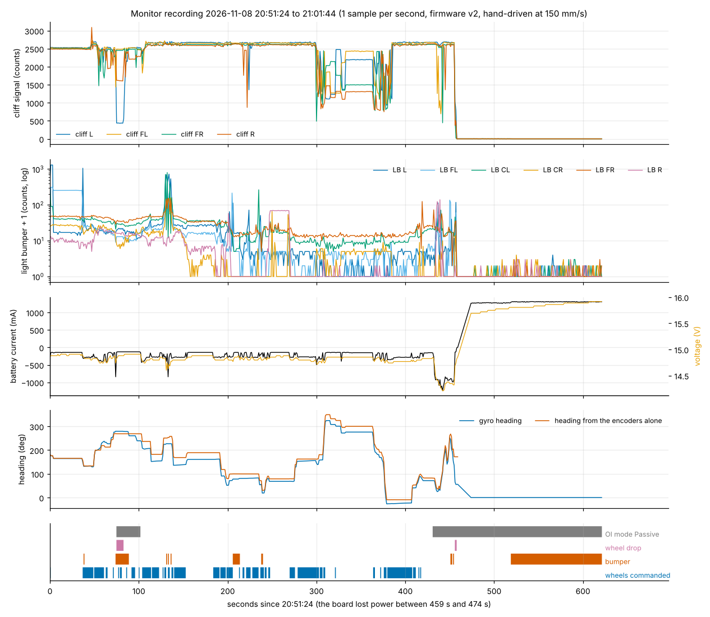
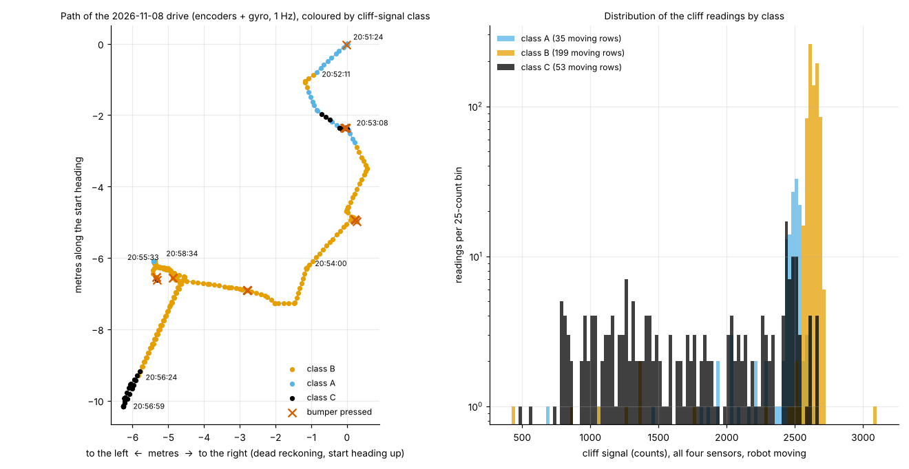
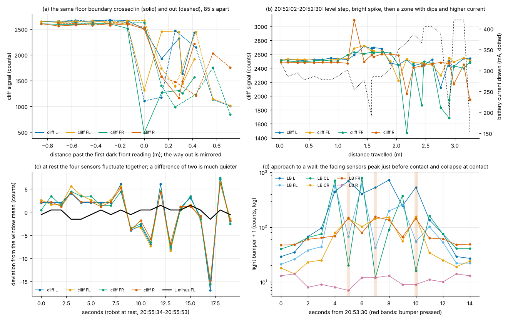
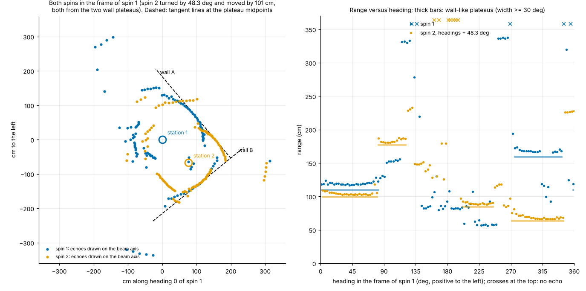
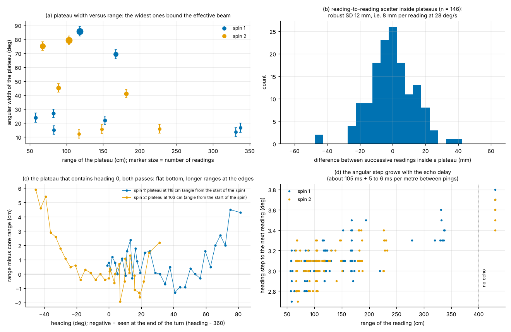
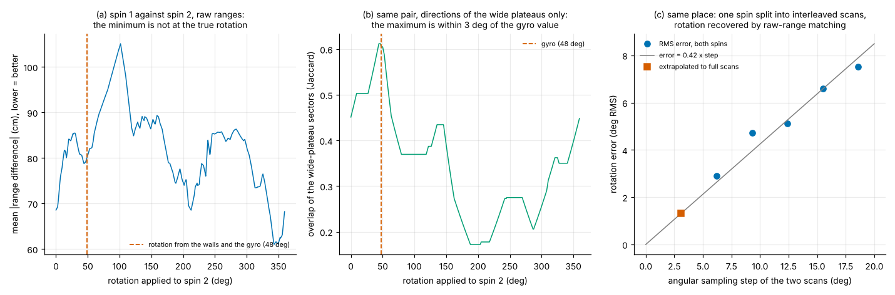
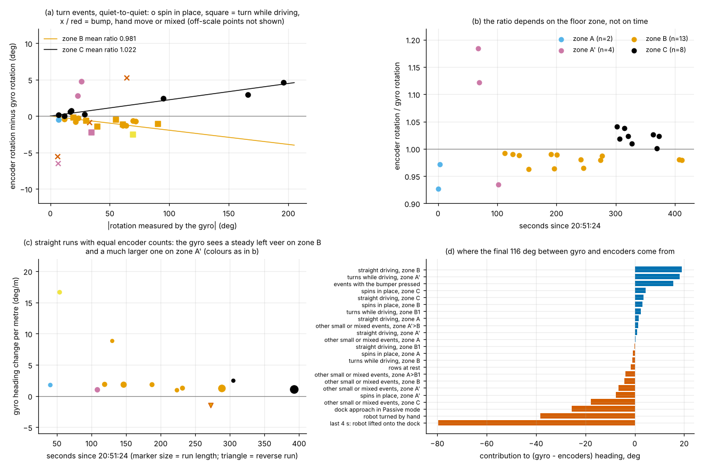
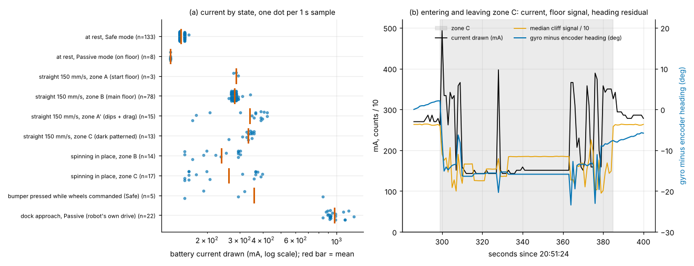

# Recorded data analysis: what the robot's own measurements say about its sensors

Scope: the six CSV files and the events file of [`mesures/`](../../mesures/) only (no web search); the PNG drawings next to them were used as a visual check. Analysis date 2026-11-10. Every number below is produced by a script of [`data_analysis/`](data_analysis/) and can be re-run with `python3 -B data_analysis/<script>.py roomba694_recherche/mesures` (scripts [a](data_analysis/a_monitor_signals.py), [b](data_analysis/b_floor_cliff_lightbumper.py), [c](data_analysis/c_gyro_encoders_effort.py), [d](data_analysis/d_spins.py), [e](data_analysis/e_position_tracks.py), helper [common.py](data_analysis/common.py); they need numpy, scipy, matplotlib and write only into `data_analysis/`). Their full printed output is kept in the five `results_*.txt` files cited below. Sample sizes are given with every figure. The recordings are one hand-driven drive, two spins and three position captures: they support measurements of noise and resolution well, comparisons between floors or places only as single cases.

Three facts about the files that differ from their description and matter for everything below:

- The monitor recording lasts 10 min 20 s (608 rows), not about 20 minutes; the robot is on the floor for the first 7 min 35 s (456 rows, 23.8 m of path) and on its dock afterwards — [results a, section 1](data_analysis/results_a_monitor_signals.txt), [results b, section 0](data_analysis/results_b_floor_cliff_lightbumper.txt).
- It was made with firmware v2, before the sonar existed: it contains no sonar range, no accelerometer, no motor current, no Wi-Fi signal strength — [monitor CSV header](../../mesures/monitor_2026-11-08_20h51.csv), [monitor_wifi.py](../../code/outils/monitor_wifi.py).
- The spin and position files contain only sonar and pose: no cliff, light-bumper, encoder, current or time column — [spin 1](../../mesures/tour_20261109_204605.csv), [position file](../../mesures/position_20261109_223239.csv). No file holds light-bumper and sonar values together.

## For each recorded signal: range of values, noise at rest, quantization, update behaviour, gaps. Which signals carry information, which are constant or pure noise?

### Takeaway
The analog floor signals (four cliff sensors) and proximity signals (six light bumpers) are quiet at rest (about 2.5 counts and under 1 count on a 0 to 4095 scale) and change by hundreds to thousands of counts with place, so they carry real information; encoders, gyro heading and battery current carry motion and effort information; battery temperature is pure noise at this time scale, the charge counter and the voltage are copies of the current, and five columns never change. The one-second sampling (14 cm of travel between rows) is the main limit of this recording, not sensor noise.

### Cited Findings

**Structure, timing and gaps of the monitor recording**
- 608 rows from 20:51:24 to 21:01:44; mean period 1.0000 s per row on both the PC clock and the board uptime (460 rows spanning 459 s before the board reboot); the PC time label has 1 s resolution (7 duplicated and 6 skipped seconds) — [results a, section 1](data_analysis/results_a_monitor_signals.txt).
- One gap: the board lost power between 20:59:03 and 20:59:18 (15 s, restart reason "mise sous tension"); the robot answered on all 608 rows — [results a, section 1](data_analysis/results_a_monitor_signals.txt).
- Until 20:58:55 (rows 0 to 451) the robot state behind each row is 0.0 to 0.3 s old (mean 0.11 s): the firmware was reading all packets in one request every 200 ms. From 20:58:56 the age rises to 0.7 s (packet-by-packet reading, about 0.6 s per cycle) — [results a, section 1](data_analysis/results_a_monitor_signals.txt), event "Query List (149) : 0 octet(s)" at 20:58:56 in the [events file](../../mesures/monitor_2026-11-08_20h51_evenements.txt).
- The gyro heading and rate of a row are read at the instant of the request, the robot values (encoders, cliff, light bumper, battery) come from the last completed poll: within a row, heading and encoders are up to 0.2 to 0.3 s apart (0.7 s at the end) — firmware v2 `handleState` and `pollTick` (git commit `de9b27b`, not in the working tree), same design in the current [web.ino](../../code/roomba694_wifi/web.ino).
- OI mode column: 404 rows in Safe (raw value 3 on this robot), 204 in Passive (raw 2); a 27 s Passive episode from 20:52:39 (left wheel-drop flag set for its first 8 s: robot stuck or lifted), then Passive again from the Seek Dock order at 20:58:35 — [results a, section 1](data_analysis/results_a_monitor_signals.txt), [events file](../../mesures/monitor_2026-11-08_20h51_evenements.txt).

**Per-signal numbers (robot on the floor; "rest SD" = median over the 6 rest windows of at least 5 samples, 118 samples in all; "moving SD" = within straight runs on the main floor, 85 degrees of freedom)** — all from [results a, sections 2 and 3](data_analysis/results_a_monitor_signals.txt)

| Signal | Range seen on the floor | Smallest step | Rest SD (worst window) | Moving SD, straight, main floor | Levels resolvable = log2(range / (rest SD x 3.46)) |
|---|---|---|---|---|---|
| cliff L / FL / FR / R (counts) | 444 to 3092 overall | 1 | 2.8 / 2.1 / 2.4 / 2.4 (5.7) | 18 / 20 / 16 / 52 | 7.8 to 8.1 bits |
| light bumper L / FL / CL / CR / FR / R (counts) | 0 to 1300 / 604 / 802 / 156 / 154 / 139 | 1 | 0.7 to 0.9 (19 once, moving object) | 2 to 64 (obstacles passing) | 5.6 to 8.7 bits |
| battery current (mA) | -1240 to -127 (charging: +1256 to +1311) | 8 (7 to 8) | 0 (2.6) | 31 | 7.3 bits |
| battery voltage (mV) | 14210 to 14909 (dock: 15692 to 15916) | 28 (27 to 28) | 10.7 (14) | 23 | 4.2 bits |
| battery temperature (deg C) | 16 to 22 | 1 | 0.85 (1.2) | 0.95 | 1 bit |
| charge counter (mAh) | 1254 to 1286 | 1 | 0.5 | 0.3 | slow ramp only |
| gyro heading (deg) | -26.7 to 324.7 | 0.1 (print) | 0.000 (dead band) | 0.9 | 11.8 bits |
| gyro rate (deg/s) | -92.8 to +80.5 | 0.1 (print) | 0.06 (0.11) | 1.6 | 9.7 bits |

- Update behaviour at rest: cliff values change on 84 to 90 % of consecutive rest rows (noise larger than one count), light-bumper values on 29 to 66 %, current on 2 %, voltage on 8 %, temperature on 52 % — [results a, section 3](data_analysis/results_a_monitor_signals.txt).
- Encoders: 1 count = 0.4446 mm; counters are signed 16-bit and each wrapped once in this drive (around 20:56:24), handled by modular differences. At the commanded 150 mm/s the encoders advance 320.1 counts/s (SD 2.0, n = 96 rows) = 142.3 mm/s, i.e. 0.949 of the command; rows show clusters at 256, 320 and 384 counts because the 200 ms poll and the 1 s sampling beat against each other — [results a, section 3](data_analysis/results_a_monitor_signals.txt).
- On straight runs the two encoders stay equal: mean (right minus left) = -0.05 count per row, never more than 3 (n = 155 rows) — [results a, section 3](data_analysis/results_a_monitor_signals.txt).
- Gyro at rest: the recorded heading does not move at all in 121 s of rest on the floor nor in 145 s on the dock (0.00 deg/min), because the firmware ignores rates below 0.3 deg/s — [results a, section 4](data_analysis/results_a_monitor_signals.txt), dead band in [roomba694_wifi.ino, `imuTask`](../../code/roomba694_wifi/roomba694_wifi.ino).
- The rate column still reveals what the dead band hides: the printed values keep the sign of zero ("-0.0" versus "0.0"), which allows a maximum-likelihood estimate below the 0.1 deg/s print step. Residual bias on the floor: -0.004 +/- 0.006 deg/s (n = 130 rest samples, four windows give +0.006, -0.011, +0.006, -0.005); on the dock after a new calibration: -0.015 +/- 0.003 deg/s (n = 146). Rate noise: 0.03 to 0.05 deg/s (1 sigma) in three floor windows and on the dock, 0.11 in the fourth window, which contains one 0.5 deg/s sample (a disturbance) — [results a, section 4](data_analysis/results_a_monitor_signals.txt).
- Without the dead band these biases would drift -0.2 +/- 0.4 deg/min (floor) and -0.9 +/- 0.2 deg/min (dock) — [results a, section 4](data_analysis/results_a_monitor_signals.txt).
- Battery: the charge counter is the integral of the current (-32 mAh counted versus -32.5 mAh integrated over 459 s; +52 versus +52.1 mAh on the dock); temperature fluctuates by +/-2 deg C from row to row with no memory (lag-1 autocorrelation +0.01); voltage follows current along a load line of 0.59 ohm (r = +0.95, n = 448) — [results a, section 5](data_analysis/results_a_monitor_signals.txt), [results c, section 6](data_analysis/results_c_gyro_encoders_effort.txt).
- The light-bumper bit of each sensor is its analog signal compared with a threshold near 125 to 140 counts: lowest value with the bit set / highest with the bit clear = 135/113 (L), 135/116 (FL), 160/90 (CL), 142/101 (CR), 134/124 (FR); the R bit never set although the signal reached 139 — [results a, section 6](data_analysis/results_a_monitor_signals.txt).
- On the dock the robot reports cliff values of 0 to 4 and light-bumper values of 0 to 3 — [results b, section 1](data_analysis/results_b_floor_cliff_lightbumper.txt).
- Constant columns: `vitesse` (150), `btn` (0), `ap_clients` (0), `robot_ok` (1), `sta_ip` — [results a, section 3](data_analysis/results_a_monitor_signals.txt).

**Sonar and pose files**
- Spin files: ranges are stored to 1 mm (all ten last digits occur); 122 and 124 readings; median heading step 3.1 deg; about 9.0 readings per second — [results d, section 1](data_analysis/results_d_spins.txt).
- The heading step between pings grows with the echo delay: 2.92 deg + 0.14 deg per metre of range, and 3.6 to 3.7 deg after a ping without echo (n = 114 per spin). With the mean rate of 27.8 deg/s this is a ping period of about 105 ms plus 5 ms per metre (sound needs 5.8 ms per metre), 130 ms after a missing echo — [results d, section 1](data_analysis/results_d_spins.txt), [figure 7d](data_analysis/fig7_spin_plateaus_beam.png); the 100 ms pause after each ping is in [radar.ino](../../code/roomba694_wifi/radar.ino).
- Position files: points are integer millimetres; the track keeps one point per 25 mm of travel (median chord 31 mm); obstacle points carry no time, range, bearing or pose; the 22:30 file is the first third of the 22:32 file (identical prefix) — [results e, sections 1 and 2](data_analysis/results_e_position_tracks.txt), [carte.ino](../../code/roomba694_wifi/carte.ino).

*Figure 1. The whole monitor recording: cliff signals, light-bumper signals (log scale), battery current and voltage, gyro heading against the heading computed from the encoders alone, and the flags — [script a](data_analysis/a_monitor_signals.py).*

### Inferences
- Signals that vary with place: the four cliff signals (floor) and the six light-bumper signals (objects within a few decimetres, and a baseline that follows the surroundings). Signals that vary with motion: encoders, gyro heading and rate, current. Signals with no information beyond these: voltage (a 6 times coarser copy of the current), charge counter (its integral), temperature (noise), and the five constant columns.
- The dead band makes "drift at rest" unmeasurable from the heading column; the real quantity to track is the rate bias, here below 0.02 deg/s (about 1 deg/min) in both sessions.
- The robot runs about 5 % slower than commanded at 150 mm/s (if 0.4446 mm per count is right, which the owner's ruler check supports to 1 to 2 % — [journal_tests.md](../../code/journal_tests.md)): commanded speed is not a substitute for the encoders.
- A row is not a simultaneous snapshot of gyro and encoders: any row-by-row comparison of the two inherits up to 0.2 s of offset, which is 14 deg at the 70 deg/s turn rate (see the encoder question).

### Gaps
- No rest recording longer than 31 s on the floor exists, so nothing can be said about the gyro bias over minutes or with temperature.
- The noise spectrum of every signal above 0.5 Hz is unknown (1 Hz sampling); the true update rate of the robot's own analog values cannot be seen.
- Sonar noise with robot and servo at rest is known only from the journal (71.4 to 71.8 cm over 44 readings — [journal_wifi.md, section 14](../../code/journal_wifi.md)), not from a file.

## Cliff signals and light-bumper signals: do they change along the drive, are the sensors correlated with a lag consistent with motion, are there step changes that look like a change of floor, and is there a relation between light-bumper values and sonar range?

### Takeaway
The cliff signals behave as a usable floor-reflectance scanner: along 24 m they show three clearly different floor signatures, level steps of about 55 times the rest noise, a dark patterned zone flagged on 99 % of its rows, and the same boundary found again on the way back within the 7 cm that one-second sampling allows. The light-bumper signals are quiet and strongly place-dependent but their response is not monotonic (the facing sensors collapse at contact), and their relation to sonar range cannot be computed because the two were never recorded together.

### Cited Findings

**Cliff signals: noise**
- Rest noise per sensor: median 2.5 counts over six windows (118 samples), i.e. about 0.08 to 0.2 % of the level; the four sensors fluctuate together (correlations +0.63 to +0.93), so a difference between two sensors is much quieter: 0.93 count, against 2.1 for the mean of the four — [results b, section 1](data_analysis/results_b_floor_cliff_lightbumper.txt), [figure 3c](data_analysis/fig3_cliff_lightbumper_details.png).
- While driving straight on the main floor the robust scatter is 9 to 15 counts per sensor (9 runs), about 5 times the rest noise — [results b, section 2](data_analysis/results_b_floor_cliff_lightbumper.txt).

**Cliff signals: zones along the drive** (zone letters are labels of this analysis; the materials are not known)
- Zone A, first 1.2 m (47 rows): median level 2511, all four sensors within 2469 to 2589, no dark reading — [results b, section 2](data_analysis/results_b_floor_cliff_lightbumper.txt).
- Zone B, the main floor (about 17 m in two visits, 236 rows in Safe mode): median 2629, 5th to 95th percentile of the four-sensor median 2616 to 2650; "median of the four at least 2580" is true on 100 % of B rows and 0 % of A rows — [results b, section 2](data_analysis/results_b_floor_cliff_lightbumper.txt).
- The A to B step is +138 counts = 55 times the rest noise of one sensor and 3.8 times the scatter seen while driving on B — [results b, section 2](data_analysis/results_b_floor_cliff_lightbumper.txt).
- Zone C, 2.05 m entered at 20:56:24 about 10 m from the start (87 rows): readings from 488 to 2668, median 1499, spread between the four sensors 1122 counts (median); at least one sensor below 2350 on 99 % of rows, against 1 % on B — [results b, section 2](data_analysis/results_b_floor_cliff_lightbumper.txt), [figure 2](data_analysis/fig2_floor_map.png).
- Zone A', 2.2 m between 20:52:17 and 20:53:11: same level as A (median 2464) but with dark dips down to 1471 on single sensors (at least one sensor below 2350 on 71 % of rows) — [results b, section 2](data_analysis/results_b_floor_cliff_lightbumper.txt), [figure 3b](data_analysis/fig3_cliff_lightbumper_details.png).
- Narrow features on the main floor: 4 of 476 sensor readings (0.8 %) are more than 150 counts below the level (deepest 871, each on one sensor for one row), and one reading is far above every other (3092 on the right sensor at 20:52:11, at the A to B step) — [results b, section 2](data_analysis/results_b_floor_cliff_lightbumper.txt).
- Texture of zone C at rest: five poses that differ only by rotations of 4 to 29 deg give completely different four-value patterns, e.g. a 4 deg rotation changes the readings by +821, +316, +150, +212 counts, while each pose is stable to 1 to 5 counts — [results b, section 5](data_analysis/results_b_floor_cliff_lightbumper.txt).

**Cliff signals: order of the sensors and repeatability**
- In the five boundary crossings of the drive (all driving forward) the front pair never changes later than the side pair; in four of the five at least one side sensor follows one row later (for example entering zone C: front sensors dark at 20:56:24, side sensors at 20:56:25; leaving it: front and right sensors bright at 20:57:49, left sensor at 20:57:50) — [results b, section 3](data_analysis/results_b_floor_cliff_lightbumper.txt), [figure 3a](data_analysis/fig3_cliff_lightbumper_details.png).
- A correlation of row-to-row changes (front pair against side pair one row later) gives Pearson +0.55 (n = 100) but Spearman +0.07: it is carried by those few large steps. On zone B alone (texture only) there is no lagged correlation at all (Pearson -0.05, n = 78) — [results b, section 3](data_analysis/results_b_floor_cliff_lightbumper.txt).
- The B/C boundary was crossed twice, 84 s apart, with 1.6 m of path and 554 deg of turning in between. The dead-reckoned robot centres at the two crossings are 271 mm apart along the path and 39 mm across; the two crossings coincide if the front sensors look 135 +/- 70 mm ahead of the centre, a plausible value for a robot of 170 mm radius — [results b, section 4](data_analysis/results_b_floor_cliff_lightbumper.txt).

**Light-bumper signals**
- Rest noise 0.7 to 0.9 count; the baseline depends on where the robot stands: between 0 and 47 counts depending on sensor and place in six rest windows, plus 68 on the right sensor and 253 on the front-left sensor in two windows where something stood close by — [results b, section 6](data_analysis/results_b_floor_cliff_lightbumper.txt).
- Strong dependence on angle: at the start the left sensor reads 1300 beside a wall and 16 after an 11.6 deg turn away — [monitor CSV rows 20:51:25 to 20:51:28](../../mesures/monitor_2026-11-08_20h51.csv).
- Only 55 of 448 on-floor rows have any light-bumper signal above 100 — [results b, section 6](data_analysis/results_b_floor_cliff_lightbumper.txt).
- Approach to one wall with three contacts (20:53:32 to 20:53:41, odometer zero at first contact): centre-left signal 74 at 27 cm, 710 at 13 cm, 802 at 3 cm, then 19, 11 and 15 at the three contacts; front-left 43, 577, 604, then 66, 41, 54; the left (side-looking) sensor stays high at contact (698, 528, 536) — [results b, section 6](data_analysis/results_b_floor_cliff_lightbumper.txt), [figure 3d](data_analysis/fig3_cliff_lightbumper_details.png).
- Of 7 bumper onsets in Safe mode, 5 had a light-bumper signal above 200 one row (2 to 13 cm) earlier; 2 obstacles were hit with every signal at 50 or below (20:52:38, 20:55:22) — [results b, section 6](data_analysis/results_b_floor_cliff_lightbumper.txt).
- During that wall approach the heading computed from the encoders turns by 7.3 deg while the gyro turns by 2.0 deg (wheels slipping against the wall), so the "distance to contact" axis is itself uncertain by a centimetre or two — [results b, section 6](data_analysis/results_b_floor_cliff_lightbumper.txt).
- No sonar value exists in the monitor file and no light-bumper value in the spin or position files — [results b, section 6](data_analysis/results_b_floor_cliff_lightbumper.txt).

*Figure 2. Left: dead-reckoned path of the drive coloured by cliff-signal class (the per-row classifier of [common.py](data_analysis/common.py)). Right: distribution of the readings by class.*

*Figure 3. (a) the B/C boundary crossed in and out; (b) the first minute: level step, bright spike, then dips with higher current; (c) common-mode noise at rest; (d) light bumper during a wall approach with three contacts.*

### Inferences
- Idea 1 (cliff sensors as floor scanner) is supported: the signals separate at least three floor signatures on a single row, and a floor boundary is a repeatable landmark at the resolution the data allow. The bright 3092 spike exactly at a level step, together with a 4 deg heading kick seen only by the gyro at the same second (see the encoder question), looks like a door sill or transition strip; this is an interpretation, the object is not identified.
- Because the rest noise is mostly common to the four sensors, features should be built from differences or ratios between sensors (floor contrast, edges) and from the spread of the four, with the common level kept as a separate, noisier channel.
- The lag between front and side sensors is visible only on large steps at 1 Hz. Using that lag as a ground-speed or slip measurement (correlating texture between front and side sensors) needs sampling at least ten times faster; the data neither support nor refute it.
- The centimetre-scale pattern of zone C cannot serve as a position fingerprint with centimetre-level pose errors, but its variance is an excellent class signature.
- Idea 2 (light bumper calibrated by sonar): feasible only on the far side of the response peak. The centre-left signal rises about tenfold between 27 and 13 cm (74 to 710) and collapses at contact, so a single value maps to two distances; a wall follower must be designed around this. The dependence on surface and angle is strong enough that one curve per sensor will not be universal.

### Gaps
- What zones A, A', B and C physically are (the owner can tell from the times and the path of figure 2).
- Whether the cliff level depends on battery voltage, ambient light or sensor height (rug pile, tilt): not separable here; the low values while the robot was stuck with a wheel drop at 20:52:39 show that height or tilt matters.
- Stability of the absolute levels from day to day: one evening only.
- The positions of the cliff sensors on the chassis are not in the repository; the 135 mm above is deduced, not measured.
- Light-bumper versus distance for known surfaces and angles, and versus sonar: no data.

## The two spins: plateaus, effective beam width versus range, scatter, dropouts, maximum range, closure, rectangular-room test, room dimensions, displacement between the spins, similarity of the signatures and the accuracy a signature match could deliver

### Takeaway
The spins contain clean plateaus (8 mm scatter per reading) whose width shows an effective sonar beam of about 75 to 80 deg for a wall closer than 1.2 m, shrinking to 10 to 20 deg beyond 2.3 m. Two wall-like surfaces at 91 to 94 deg from each other are seen from both stations; their midpoints give the rotation between the spins as 47.1 and 49.5 deg against 48 deg from the gyro, and their distances give a displacement of 1.01 +/- 0.02 m against the stated "about one metre". Raw range-versus-heading correlation recovers the heading at the same place (about 0.4 of the angular step) but fails completely between the two stations; room dimensions cannot be established, and the 20 deg overlap does not validate the full turn in the way the notes say.

### Cited Findings

**Basics**
- Spin 1: 122 readings over 377.4 deg, 5 without echo (4.1 %), echoes from 56.1 to 337.9 cm. Spin 2: 124 readings over 379.0 deg, 7 without echo (5.6 %, all between 113 and 147 deg), echoes from 66.2 to 233.1 cm — [results d, section 1](data_analysis/results_d_spins.txt).
- The longest echo recorded is 3.38 m; nothing between 3.4 m and the 4 m limit of the firmware appears in either spin — [results d, section 1](data_analysis/results_d_spins.txt), limit in [radar.ino](../../code/roomba694_wifi/radar.ino).

**Plateaus and scatter** (a plateau here = consecutive echoes that change by at most 4 cm or 3 % from one to the next, one outlier bridged, at least 4 readings and 9 deg)
- 86 of 117 echoes (74 %) of spin 1 and 99 of 117 (85 %) of spin 2 lie inside a plateau; 8 plateaus in spin 1, 7 in spin 2 — [results d, section 2](data_analysis/results_d_spins.txt).
- Single-reading scatter inside plateaus, from successive differences: median 8.4 mm over 9 plateaus (5.2 to 15.7 mm); pooled over 146 differences, 8.4 mm; isolated outliers bridged: 6 of 234 echoes (2.6 %) — [results d, section 2](data_analysis/results_d_spins.txt), [figure 7b](data_analysis/fig7_spin_plateaus_beam.png).
- The same wall re-measured about 13 s later on the overlap: differences of +9, -8, -44, +17, -27, -9 mm (spin 1) and +2, +6, -26, +16, +12, -10, -3 mm (spin 2); SD 23 and 14 mm, median absolute difference 13 and 10 mm — [results d, section 4](data_analysis/results_d_spins.txt).
- Range excess at the plateau edges: the first or last three readings of the wide plateaus are 0.5 to 6.1 cm longer than the central half (+53 mm, +61 mm, +45 mm, +36 mm on the four wall plateaus' longer side) — [results d, section 2](data_analysis/results_d_spins.txt), [figure 7c](data_analysis/fig7_spin_plateaus_beam.png).
- The owner's tool splits the widest plateau of spin 1 in two (65 deg at 43 deg and 18 deg at 368 deg) because of one outlier at 7.1 deg; bridged and joined across 360 deg it is 82 deg wide and centred on 40 deg — [results d, section 2](data_analysis/results_d_spins.txt).

**Plateau width versus range** — [results d, section 3](data_analysis/results_d_spins.txt), [figure 7a](data_analysis/fig7_spin_plateaus_beam.png)

| Range of the plateau | Width (between last readings on it .. first readings off it) | Spin |
|---|---|---|
| 67.6 cm | 72 .. 78 deg | 2 |
| 103.4 cm | 76 .. 83 deg | 2 |
| 118.1 cm | 82 .. 89 deg | 1 |
| 167.4 cm | 66 .. 73 deg (a nearer object hides 5 readings in the middle) | 1 |
| 181.4 cm | 38 .. 44 deg | 2 |
| 226.9 cm | 13 .. 19 deg | 2 |
| 330.9 and 337.3 cm | 10 .. 17 and 14 .. 20 deg | 1 |

- Other plateaus are narrower at the same ranges (9 to 42 deg between 58 and 153 cm): a plateau can be narrower than the beam, not wider — [results d, section 3](data_analysis/results_d_spins.txt).
- Drawn as points on the beam axis, a wall plateau becomes an arc that bulges 22 to 29 cm in front of the wall line at 1.0 to 1.7 m — [results d, section 3](data_analysis/results_d_spins.txt), [figure 6](data_analysis/fig6_spins_common_frame.png).

**Closure**
- In both spins the whole overlap (6 and 7 readings beyond 360 deg) falls inside one plateau that is 82 and 76 deg wide, so equal ranges at the start and the end do not test the angle — [results d, section 4](data_analysis/results_d_spins.txt).
- The only edge seen on both passes bounds the gyro on one side: it does not under-count a turn by more than 1.3 % (spin 1) or 4.2 % (spin 2). An over-count cannot be excluded by this test at any size — [results d, section 4](data_analysis/results_d_spins.txt).

**Walls, rotation and displacement between the spins**
- Wall-like plateaus (at least 30 deg and 10 readings): spin 1 has two, 118.1 cm centred on 40.1 deg (called wall A below) and 167.4 cm centred on 308.9 deg (wall B), 91.1 deg apart; spin 2 has four, of which 103.4 cm at 353.0 deg (wall A again) and 67.6 cm at 259.4 deg (wall B again) are 93.6 deg apart — [results d, section 5](data_analysis/results_d_spins.txt).
- Matching only the directions of the wide plateaus of the two spins gives a best rotation of 45.2 deg (overlap index 0.61; next best 0.50 at 9 deg). The two matched pairs give 47.1 deg (wall A) and 49.5 deg (wall B), mean 48.3 deg; the journal's gyro value is 48 deg (381 deg of spin plus 27 deg while the robot was carried) — [results d, section 6](data_analysis/results_d_spins.txt), [figure 8b](data_analysis/fig8_signature_matching.png), [journal_wifi.md, section 17](../../code/journal_wifi.md).
- Distance to wall A: 118.1 to 103.4 cm (+14.7 +/- 0.4, statistical); to wall B: 167.4 to 67.6 cm (+99.8 +/- 0.7). Displacement: 100.9 cm if the walls are at 90 deg, 102.0 cm at 93.6 deg; 100.7 to 101.8 cm when the central 30 to 70 % of each plateau is used — [results d, section 6](data_analysis/results_d_spins.txt).
- With that rotation and displacement the echoes of both spins fall on the same two tangent lines, and a far feature seen from both stations (319.7 cm at 349 deg in spin 1, 226.9 cm in spin 2) lands at the same place — [figure 6](data_analysis/fig6_spins_common_frame.png), [results d, section 6](data_analysis/results_d_spins.txt).
- No plateau opposite to wall A or wall B is consistent between the two spins (candidates opposite A: 57 and 82 cm in spin 1, 89 cm in spin 2; the 3.3 m echoes of spin 1 have no counterpart within range in spin 2) — [results d, sections 2 and 6](data_analysis/results_d_spins.txt).
- Between the two wall plateaus (headings 345 to 355 deg) spin 1 returns no echo twice, 3.2 m once and 1.24 m once — [spin 1 CSV](../../mesures/tour_20261109_204605.csv).

**Signature matching**
- Spin 1 against spin 2 with raw ranges: the best rotation is 343 deg (mean absolute difference) or 350 deg (Pearson 0.30); at the true rotation the score ranks 271st of 720 and the Pearson correlation is 0.04 — [results d, section 7](data_analysis/results_d_spins.txt), [figure 8a](data_analysis/fig8_signature_matching.png).
- Same place: one spin split into interleaved sub-scans and matched pairwise. RMS rotation error 2.9 deg at 6.2 deg sampling, 4.7 at 9.3, 5.1 at 12.4, 6.6 at 15.5, 7.5 at 18.6 deg (both spins, 1 to 15 pairs each): error = 0.42 x sampling step. Extrapolated to two full scans (3.1 deg step): about 1.3 deg — [results d, section 7](data_analysis/results_d_spins.txt), [figure 8c](data_analysis/fig8_signature_matching.png).
- 200 random half/half splits per spin: rotation error SD 2.9 and 3.3 deg, median absolute error 2.1 deg, 0 and 1 splits beyond 10 deg (mean-absolute-difference metric; Pearson is worse: SD 3.5 and 4.5 deg, 1 and 9 splits beyond 10 deg) — [results d, section 7](data_analysis/results_d_spins.txt).
- Similarity: interleaved halves of the same spin correlate at 0.76 to 0.84; spin 1 against spin 2 reaches at most 0.30, at a wrong rotation — [results d, section 7](data_analysis/results_d_spins.txt).

**Gyro scale from the two spins**
- The gyro counted 408 deg between the two starts; the walls say 360 + 48.3 deg. Allowing the gyro to count (1+e) degrees per true degree (which also rescales the wall directions inside each spin), the two agree for e = -0.09 %; the mismatch grows by 3.6 deg per 1 % of e, so +/-1.5 deg on the wall midpoints and +/-2 deg on the hand-carry figure give e = -0.1 +/- 0.7 %. A gyro reading 2 % high would leave 7.4 deg of mismatch — [results d, section 6](data_analysis/results_d_spins.txt).

*Figure 6. Left: both spins in the frame of spin 1, spin 2 turned by 48.3 deg and moved by 101 cm (both values from the two wall plateaus only); dashed lines are the tangents at the plateau midpoints. Right: range against heading with the wall-like plateaus marked.*

*Figure 7. (a) plateau width against range; (b) reading-to-reading scatter inside plateaus; (c) shape of the plateau that contains heading 0; (d) heading step against range.*

*Figure 8. (a) raw-range matching of spin 1 against spin 2; (b) matching of the wide-plateau directions only; (c) same-place rotation error against angular sampling.*

### Inferences
- Effective beam: the widest plateaus bound it at about 75 to 80 deg for a flat wall within 1.2 m, about 70 deg at 1.7 m and 10 to 20 deg beyond 2.3 m; the 38 to 44 deg plateau at 1.8 m may be a narrower object, so the fall-off between 1.7 and 2.3 m is not pinned down. This agrees with simple physics under one assumption (a 40 kHz piston 16 mm across has its first null 41 deg off axis, so a main lobe about 80 deg wide): a strong flat reflector at short range is heard over the whole main lobe, a weak or distant one only near the axis. The notes' "15 deg" describes the far range only.
- The longer ranges at plateau edges (up to 6 cm) are most simply explained by a weaker echo crossing the detection threshold later; an offset of the sensor from the rotation centre would give a similar shape, and the two cannot be separated with this data. The wall distance should therefore be taken from the central half of a plateau.
- Accuracy a station-to-station match could deliver, on this single pair: heading within about 1 to 2.5 deg from two wall midpoints (both walls agree with the gyro within 1.5 deg, and the plateau widths differ by 6 deg between stations); position within about 1 to 2 cm along each wall normal, provided the same walls are identified at both stations. Without walls on two non-parallel directions the displacement is not observable this way.
- Accuracy at the same place: about 3 deg (1 sigma) with half of the readings, about 1.3 deg expected with full scans; the error scales with the angular step, so a slower spin or faster pinging improves it in proportion. This is a real route to resetting the heading at a known station such as the dock.
- Raw correlation of the range curve is a recognition tool for the same spot only. One metre away the curve is a different curve (correlation 0.04 at the true rotation). Between stations the invariant is the set of wall directions, not the ranges.
- The room is not a simple rectangle seen from these two stations: two perpendicular flat surfaces are confirmed, with an opening where they would meet; what faces them is furniture or clutter at 57 to 90 cm. The robot's position is known relative to those two surfaces (118 and 167 cm, then 103 and 68 cm, each plus the unmeasured offset of the sensor from the robot centre).
- The gyro scale check favours the gyro: within about 1 % over 408 deg. Together with the encoder question below, the 2 % disagreement between encoders and gyro on the hard floor then belongs to the wheel side (effective wheel base or wheel diameter). This rests on one number that is not in the data files (the 27 deg read while the robot was carried by hand).
- The statement in the notes that "the end of each spin finds its start again, so the gyro counts a full turn" is weaker than it reads: the test only excludes an under-count larger than 1.3 %.

### Gaps
- Room dimensions and the true positions of the two stations: no tape measurement exists; "about one metre" is itself an estimate.
- The offset of the sonar from the rotation centre is unknown and uncorrected everywhere; it cancels in the displacement but not in absolute wall distances.
- Only two stations: no estimate of how fast the signature decorrelates with distance (between 0 and 1 m), nor of false matches between different places.
- No same-place repeat spin: the 1.3 deg figure is an extrapolation from split scans.
- Encoders and time were not recorded during the spins: the mean rate of 27.8 deg/s against a commanded 30.2 deg/s cannot be split into wheel speed and slip.
- Whether the plateau-direction matching works in other rooms: one success on one pair.

## Encoders versus gyro: ratio of the rotation counted by the wheels to the rotation measured by the gyro (the notes report 0.963), drift at rest, consistency during straight lines, what the 4 cm closure of the square implies

### Takeaway
Compared properly (between moments when both signals are steady), the wheels and the gyro agree far better than the notes suggest, and their ratio depends on the floor: 0.981 +/- 0.003 on the main floor (13 turns), 1.022 +/- 0.005 on the dark patterned zone (8 turns), 1.12 to 1.18 on the third zone (2 turns). The 0.963 of the notes and the "5 to 10 % encoder excess" of the journal are artefacts of one-second sampling and of mixing hand moves, bumps and slip; the 116 deg final disagreement is mostly the robot being moved by hand. On straight lines the gyro sees a steady left veer of 1.3 deg per metre that the encoders cannot see, and the 4 cm closure of the square cannot tell which heading source is right.

### Cited Findings

**Whole record**
- On the floor (rows 0 to 455) the gyro turned -47.3 deg net and the encoders -11.1 deg: 36 deg apart. In the last 4 s before the board reboot the gyro turned a further -79.7 deg with both wheel-drop flags set and the encoders frozen, which gives the 116 deg of the notes — [results c, section 1](data_analysis/results_c_gyro_encoders_effort.txt).
- Row-by-row regression of encoder rotation on gyro rotation: slope 0.967 (rows 0 to 455), 0.991 (rows 0 to 431); ratio of summed absolute rotations 0.950 and 0.932: the "whole-record ratio" depends on the method and on where the record is cut (the notes quote 0.963) — [results c, section 1](data_analysis/results_c_gyro_encoders_effort.txt), [note H](../../notes/H_cartographie_strategie.md).

**Turn events between quiet moments** (45 events; a quiet row has at most 3 counts of encoder difference and 1 deg of heading change since the previous row)
- Main floor (zone B): 7 spins in place give 0.979 (SD 0.012), 6 turns while driving give 0.982 (SD 0.010); together n = 13, mean 0.981, SD 0.011, standard error 0.003; left turns 0.981 (n = 8), right turns 0.980 (n = 5) — [results c, section 2](data_analysis/results_c_gyro_encoders_effort.txt), [figure 4a, 4b](data_analysis/fig4_gyro_vs_encoders.png).
- Dark patterned zone (C): 8 spins in place, 539 deg in total, mean 1.022, SD 0.013, standard error 0.005. Difference to zone B: +0.042 (Welch t = 7.5) — [results c, section 2](data_analysis/results_c_gyro_encoders_effort.txt).
- Zone A': 2 spins, 1.184 and 1.122. Zone A: 2 small turns (7 and 12 deg), 0.927 and 0.972 — [results c, section 2](data_analysis/results_c_gyro_encoders_effort.txt).
- Expressed as an effective wheel base with the gyro taken as reference: 230.4 mm on zone B and 240.3 mm on zone C, for a nominal 235 mm — [results c, section 2](data_analysis/results_c_gyro_encoders_effort.txt).
- Rotation speed of the body in a commanded 150 mm/s spin: 71 to 72 deg/s on zones A and B (medians, n = 2 and 10), 66.8 deg/s on zone C (n = 7) — [results c, section 5](data_analysis/results_c_gyro_encoders_effort.txt).
- The monitor tool's own episodes for the same evening (events file): 6 rotations in place of at least 15 deg, ratio mean 1.08, SD 0.118, range 0.94 to 1.28 — ten times the scatter of the quiet-to-quiet comparison — [results c, section 2](data_analysis/results_c_gyro_encoders_effort.txt), [events file](../../mesures/monitor_2026-11-08_20h51_evenements.txt).

**Straight runs**
- Zone B, 7 forward runs of at least 0.4 m without contact (10.65 m, 75 s; the last run begins with 0.7 m on zone C): the gyro heading rises by +1.33 deg per metre (length-weighted; per-run mean +1.43, SD 0.40, range +0.94 to +1.87), i.e. +0.19 deg/s, while the encoders count the same on both wheels. The per-run value falls from +1.87 to +1.05 deg/m over five minutes — [results c, section 3](data_analysis/results_c_gyro_encoders_effort.txt), [figure 4c](data_analysis/fig4_gyro_vs_encoders.png).
- The single reverse run (0.54 m in 4 s) shows -0.8 deg, i.e. -1.5 deg per metre travelled: the sign flips — [results c, section 3](data_analysis/results_c_gyro_encoders_effort.txt).
- The rate bias measured at rest in the same session is -0.004 +/- 0.006 deg/s, fifty times smaller than +0.19 deg/s — [results a, section 4](data_analysis/results_a_monitor_signals.txt).
- On zone A' the gyro shows +16.6 deg per metre over 0.54 m with equal encoder counts and a current 25 % above normal — [results c, section 3](data_analysis/results_c_gyro_encoders_effort.txt).

**Where the 116 deg come from** (gyro minus encoders; the parts sum to -115.9) — [results c, section 4](data_analysis/results_c_gyro_encoders_effort.txt), [figure 4d](data_analysis/fig4_gyro_vs_encoders.png)

| Contribution | deg |
|---|---|
| Last 4 s: robot lifted or swung onto the dock (wheel drops, encoders frozen) | -79.7 |
| Robot turned by hand in Passive mode at 20:52:52 and 20:53:00 (encoders see nothing) | -38.2 |
| Dock approach driven by the robot itself (Passive, bumps) | -25.6 |
| Straight driving on zone B, 15.3 m (the left veer) | +19.1 |
| Turns while driving on zone A' | +18.1 |
| Entering zone C: -17.1 deg on the gyro, +0.1 on the encoders, within 2 s, current peak 493 mA | -17.2 (within "mixed events, zone C" -17.8) |
| Events with the bumper pressed | +15.7 |
| All spins in place on zones B and C together | +7.6 |
| Everything else | about -15 in total, each item below 8 |

- Other single events: -4.1 deg on the gyro alone at the A to B step with the bright cliff spike (20:52:10); +6.0 deg on the gyro alone when hitting an obstacle obliquely (20:54:49); encoders +4.8 deg with the gyro still while backing off a wall (20:53:38) — [results c, section 4](data_analysis/results_c_gyro_encoders_effort.txt).

**The square of 2026-11-09**
- The track (57 points, chords summing to 1734 mm for 1.79 m reported) ends at (-37, +10) mm: 38.3 mm from the start, 2.1 % of the path — [results e, section 1](data_analysis/results_e_position_tracks.txt).
- Heading budget of the track, which is drawn with the gyro heading: start +1.0 deg, three corners +257.0 deg (91.8, 82.0, 83.2), bends along the four straight sides +14.3 deg (2.1, 3.0, 5.1, 4.1 deg over 431, 396, 398, 385 mm, i.e. 4.8 to 12.8 deg per metre): total 272.2 deg, the value reported by the firmware; the wheels alone reported 272.9 deg — [results e, section 1](data_analysis/results_e_position_tracks.txt), [journal_wifi.md, section 19](../../code/journal_wifi.md).
- Re-drawing the same chords with other headings: gyro heading 38 mm of closure; straight sides with corners scaled to end at 272.9 deg (what the wheels alone would roughly give) 37 mm; an ideal square with three 90 deg corners 42 mm; gyro corners but straight sides 85 mm — [results e, section 1](data_analysis/results_e_position_tracks.txt).
- Each 1 % of gyro scale moves the end point by about 20 mm; a closure under 60 mm is compatible with scale errors from -1.2 % to +4.8 %; a distance-scale error does not appear in a closed path at all — [results e, section 1](data_analysis/results_e_position_tracks.txt).

*Figure 4. (a) turn events, encoder minus gyro rotation; (b) ratio by floor zone; (c) gyro veer on straight runs; (d) decomposition of the final 116 deg.*

### Inferences
- The scale ratio in rotation is not one number: it is a property of the floor. On the main hard floor the wheels count 1.9 +/- 0.3 % less rotation than the gyro; on the dark patterned zone 2.2 % more; on zone A' 12 to 18 % more. A calibration made on one floor is wrong by 4 % on the next, and the ratio itself is a slip and floor indicator.
- Which of the two is right on the hard floor? The spins of 2026-11-09 put the gyro within about 1 % (previous question), so the 1.9 % most likely belongs to the wheels (effective wheel base near 230 mm, or wheels 1.9 % larger than 72 mm). This holds only if the 27 deg hand-carry reading of the journal is right to a few degrees.
- The straight-line veer is most likely a real curve of radius about 43 m (the right wheel travelling 0.55 % more per count than the left): the bias at rest is far too small to explain it and the one reverse run flips sign as a wheel mismatch predicts and a gyro bias does not. The evidence is thin (one reverse run of 4 s; the forward value drifts from 1.9 to 1.1 deg/m), so a motion-induced gyro error is not excluded.
- In the square the two heading sources agree within 1 deg at the end although they disagree by 8 to 14 deg on the sides and by the opposite amount in the corners (if, as on the previous day, the encoders count equal on straight sides): the wheels over-count the corners by roughly 4 to 6 % and the gyro sees 5 to 13 deg per metre of veer. This resembles zone A' of the previous day rather than the main floor. The final agreement is a coincidence of two compensating effects, not a validation.
- The 4 cm closure shows that the distance bookkeeping is consistent to a few centimetres over 1.8 m. It has no power to rank gyro against wheels: both headings close the loop equally well, and a closing error of a few centimetres made by eye is as large as a 2 % heading-scale effect.
- Slip detection is feasible in principle: every large disagreement in the record has a physical cause that the other signals confirm (edge of zone C, the level step with the bright spike, bumps, hand moves) and the three signals (heading residual, current, cliff) move together at the edge of zone C (figure 5b). Zone C behaves like a rug (darker, patterned, more drag, more wheel slip, a heading kick on entry), which is an interpretation. At 1 Hz it can only be seen after the fact.

### Gaps
- No external angle reference in any file: gyro scale is supported only indirectly through the two spins and one journal figure.
- No log of the 2026-11-09 sessions other than tracks: speed, floor and encoder values of the square are unknown, so the corner/side split above is inferred from the track shape.
- Veer versus speed and direction (per metre or per second?) cannot be separated: all runs are at 150 mm/s, one reverse run.
- The mean rotation rate in the spins (27.8 deg/s for 30.2 commanded) cannot be explained without encoder data.

## Battery voltage and current versus motion: is the current a usable effort signal at this sampling rate?

### Takeaway
Yes for steady states, no for events. With 8 mA steps and almost no noise at rest, the battery current separates rest (145 mA), straight driving on the main floor (281 mA) and straight driving on the two other surfaces (334 and 340 mA) well enough that a single one-second sample tells the main floor from the dark zone 97 % of the time; pushes against obstacles (842 mA) and the entry onto the dark zone (493 mA) are caught only by luck at 1 Hz. Voltage adds nothing.

### Cited Findings
- Current by state — [results c, section 6](data_analysis/results_c_gyro_encoders_effort.txt), [figure 5a](data_analysis/fig5_current_effort.png):

| State | n rows | Mean (mA) | SD | Min .. max |
|---|---|---|---|---|
| At rest, Safe mode | 133 | -145.0 | 3.6 | -159 .. -143 |
| At rest, Passive mode | 8 | -127.0 | 0.0 | -127 |
| Straight at 150 mm/s, zone B (main floor) | 78 | -280.5 | 10.7 | -342 .. -262 |
| Straight, zone A (start) | 3 | -286.0 | 8.0 | -294 .. -278 |
| Straight, zone C (dark patterned) | 13 | -334.0 | 25.7 | -358 .. -262 |
| Straight, zone A' | 15 | -340.1 | 87.0 | -421 .. -167 |
| Spinning in place, zone B / zone C | 14 / 17 | -240 / -262 | 59 / 104 | (partial seconds included) |
| Bumper pressed, wheels commanded | 5 | -359 | 279 | -842 .. -151 |
| Dock approach in Passive (robot drives itself) | 22 | -971 | 103 | -1240 .. -842 |
| Charging on the dock | 146 | +1294.5 | 15.5 | +1256 .. +1311 |

- Current above rest when driving straight: 135 mA on zone B, 189 mA on zone C (+40 %), 195 mA on zone A' (+44 %) — [results c, section 6](data_analysis/results_c_gyro_encoders_effort.txt).
- Zone B against zone C: 54 mA = 7 quantization steps, separation d' = 2.7; a threshold at -307 mA classifies 97 % of 91 single rows correctly (always answering "B" would score 86 %, since 78 of the 91 rows are B). Zone B against A': d' = 1.0 (the A' rows are few and mixed), 95 % of 93 rows (84 % for the trivial rule) — [results c, section 6](data_analysis/results_c_gyro_encoders_effort.txt).
- Transients caught by the one-second sampling: -842 mA at two bumper contacts (20:52:38, 20:53:37) and -493 mA when entering zone C (20:56:24); of 7 bumper onsets in Safe mode only 2 show a current beyond -440 mA — [results c, section 6](data_analysis/results_c_gyro_encoders_effort.txt).
- Voltage: one 28 mV step corresponds to 47 mA on the 0.59 ohm load line (r = +0.95): voltage is a six times coarser copy of the current — [results c, section 6](data_analysis/results_c_gyro_encoders_effort.txt).
- Entering and leaving zone C, the current, the cliff level and the gyro-minus-encoder heading change within the same seconds — [figure 5b](data_analysis/fig5_current_effort.png).

*Figure 5. (a) current by state, one dot per one-second row; (b) the passage over zone C. The lasting steps of the blue curve are real (entry onto zone C); its brief spikes during spins are the 0.2 s offset between heading and encoders inside a row, not slip.*

### Inferences
- Idea 5 is supported for floor type at steady speed: a rise of 40 % in drive current coincides with the two surfaces where the cliff signals and the wheel slip also change. Averaged over two or three seconds the separation would be near-certain.
- The signal is the total battery current: it includes the electronics (127 to 145 mA) and anything else the robot switches on. The dock approach draws about 1 A for reasons the file does not show, so thresholds are valid only for a known set of running motors and one speed.
- Pushing and stall detection needs faster sampling: a push shows six times the driving current but lasts less than the sampling period.

### Gaps
- The per-wheel motor currents (OI packets 54 and 55), which the current firmware reads, were not recorded: the split between left and right wheel, the most direct effort and slip signal, is missing.
- No slope exists in the recording; nothing can be said about slope sensing.
- One speed only (150 mm/s); the dependence on speed, battery level and temperature is unknown.
- The bandwidth of the robot's current measurement is unknown at 1 Hz.

## What would have to be logged (which raw signals, at what rate, with what timestamps) to settle each of the seven candidate ideas properly?

### Takeaway
Almost everything missing is a logging problem, not a sensor problem: one time-stamped record per robot poll at 20 to 50 Hz with all analog signals, the raw gyro and accelerometer, the motor currents and the Wi-Fi signal strength, plus one record per sonar ping, would settle six of the seven ideas in an afternoon of scripted runs; the seventh (Wi-Fi) has no data at all today. The single most useful immediate step needs no new code: record the existing 5 Hz CSV log during the next drive, since it already puts cliff, light-bumper, sonar, encoders, current and heading on one line.

### Cited Findings

**Evidence already in the recordings, idea by idea**

| Idea | For | Against or limits | Sample | Source |
|---|---|---|---|---|
| 1. Cliff sensors as floor scanner | rest noise 2.5 counts, 0.9 for a difference of two sensors; level step A to B = 55 x noise; zone C flagged on 99 % of rows, B on 1 %; boundary found again within the 7 cm sampling limit | 14 cm between rows; zones A and A' have the same level; height and tilt not separated from reflectance; readings are 0 on the dock | 456 rows, 5 crossings, 1 boundary crossed twice | [results b](data_analysis/results_b_floor_cliff_lightbumper.txt) |
| 2. Light bumper against sonar | light bumper quiet (under 1 count), signal rises about tenfold between 27 and 13 cm | never recorded with the sonar; response collapses at contact (19, 11, 15 after 710 to 802); 2 of 7 bumped obstacles invisible | 1 wall, 3 contacts, 7 bumps | [results b, section 6](data_analysis/results_b_floor_cliff_lightbumper.txt) |
| 3. Spin signature | same place: rotation error 0.42 x angular step, similarity about 0.8; two wall directions give the rotation within 1.5 deg of the gyro and the displacement as 1.01 m | raw correlation between the two stations fails (best rotation about 65 deg off, correlation 0.04 at the true one) | 2 spins | [results d, sections 6 and 7](data_analysis/results_d_spins.txt) |
| 4. Walls, room size, beam width | 74 to 85 % of echoes in plateaus, 8 mm scatter; beam 75 to 80 deg within 1.2 m, 10 to 20 deg beyond 2.3 m; two surfaces at 91 to 94 deg | no consistent opposite walls: room size not obtainable; arcs bulge 22 to 29 cm in a point map; sensor offset unknown | 15 plateaus, 2 walls | [results d, sections 2 to 6](data_analysis/results_d_spins.txt) |
| 5. Current as effort | 281 mA on the main floor against 334 and 340 mA elsewhere; 97 % single-row classification B against C; 842 mA when pushing | total battery current only; events missed at 1 Hz; no slope in the data; about 1 A during the robot's own dock approach | 78 + 13 + 15 rows | [results c, section 6](data_analysis/results_c_gyro_encoders_effort.txt) |
| 6. Gyro against encoders | ratio 0.981 +/- 0.003 (B), 1.022 +/- 0.005 (C), 1.12 to 1.18 (A'); veer +1.33 deg/m; rest bias under 0.02 deg/s; every large disagreement has a physical cause | timing offset inside each row; no external reference; the square cannot rank the two | 45 turn events, 7 straight runs | [results c](data_analysis/results_c_gyro_encoders_effort.txt), [results e](data_analysis/results_e_position_tracks.txt) |
| 7. Wi-Fi signal strength as map layer | none | no signal strength in any file; the state API does not expose it (only the network scan does) | 0 | [monitor CSV](../../mesures/monitor_2026-11-08_20h51.csv), [web.ino](../../code/roomba694_wifi/web.ino) |

**What exists today for logging**
- The firmware already offers a CSV line every 200 ms (key `j`) with board time in ms, both encoders, bumper and wheel-drop flags, four cliff signals, six light-bumper signals, voltage, current, mode, gyro heading and rate, the front sonar distance and the pose; none of the files in `mesures/` is such a log — [README, "Journal CSV"](../../code/README.md), [`printCsvLine`](../../code/roomba694_wifi/roomba694_wifi.ino).
- That line lacks: the two wheel motor currents, brush currents, wall signal, stasis and infrared bytes although the firmware reads them every poll; the accelerometer; the unrounded gyro rate; the Wi-Fi signal strength; and each individual sonar ping (it prints the median of the last three front readings, up to 3 s old) — [`parseState` and `printCsvLine`](../../code/roomba694_wifi/roomba694_wifi.ino), [`radarFrontMm`](../../code/roomba694_wifi/radar.ino).
- A full reply to the 80-byte sensor group arrives in 13 to 17 ms on this robot, and the robot can stream packets every 15 ms — [README, "Lecture des capteurs"](../../code/README.md), [note A, opcode 148](../../notes/A_doc_officielle_OI.md).
- At the measured 142 mm/s one row per second is 142 mm of travel, the 5 Hz log 28 mm — [results a, section 3](data_analysis/results_a_monitor_signals.txt).

### Inferences

**Logging wish-list (records)**

| Record | Fields | Rate | Timestamp |
|---|---|---|---|
| R1 robot poll | encoders L/R; bump and wheel-drop bits; 4 cliff signals; 6 light-bumper signals and their bits; wall signal; battery current, voltage; left and right wheel motor currents, brush currents; stasis; mode; requested wheel speeds (to know the command in force) | 20 Hz for drives (7 mm per record at 142 mm/s), 50 Hz in bursts of 30 to 60 s for floor texture (2.8 mm); a short packet list instead of the 80-byte group makes 50 Hz comfortable | board `micros()` at the moment the request is sent, plus a sequence number; never the PC clock |
| R2 inertial | gyro z rate before the dead band and bias subtraction (and the bias in use), gyro x and y, accelerometer x, y, z, integrated heading to 0.01 deg | 50 to 100 Hz (the task already runs at 100 Hz); 10 Hz is enough for rest tests | same clock; R1 should also carry the heading sampled at its own request instant |
| R3 sonar ping | raw echo time in microseconds (or "no echo" / "no reaction"), servo angle, gyro heading at the trigger, pose at the trigger | every ping (9 to 16 per second) | board `micros()` at the trigger |
| R4 events | every drive order sent (wheel speeds), mode changes, bumper edges, spin start and stop with encoder values | on occurrence | same clock |
| R5 radio | signal strength of the home network connection | 1 to 2 Hz | same clock |
| R6 ground truth, by hand | tape-measured room dimensions and station positions; offset of the sonar from the wheel axis centre; floor material of each zone; speed setting; photos | once per session | written in the journal |

A burst mode (fill a buffer in memory at full rate, download afterwards) avoids losing rows to Wi-Fi; a 60 s burst of 50 Hz records of about 40 bytes is 120 kB.

**Runs that would settle each idea**

1. Cliff scanner. (a) 60 s at rest at 50 Hz on each floor: noise spectrum, common-mode part, dependence on battery voltage. (b) Straight passes of 2 m at 100 mm/s at 50 Hz over each floor and across each boundary and door sill, three times in each direction: repeatability of the profile against the odometer, lag between front and side sensors (of the order of half a second to a second depending on speed and on the sensor positions, to be timed to a few percent). (c) The same spot with 1, 2 and 3 mm shims under the wheels: sensitivity to height. (d) Lights on and off. (e) The same passes on another day.
2. Light bumper against sonar. Approach a flat wall from 1 m at 50 mm/s and back away, R1 at 20 Hz plus R3, bumper contact as the zero of distance; repeat for a white wall, dark furniture and a glossy surface, at 0, 30 and 60 deg of incidence. This gives each sensor's curve, the position of its peak and the dead zone near contact.
3. Spin signature. At tape-measured stations: three spins at the same station (repeatability), then stations 5, 10, 20, 50 and 100 cm apart (how fast the signature changes), each spin two full turns, at 30 and 15 deg/s, with R1 to R3. Two turns give every edge twice, 360 deg apart: a two-sided closure test.
4. Walls and beam. The robot at 0.5, 1, 1.5, 2 and 3 m from a long bare wall, two full turns each: plateau width and edge excess against range for a known flat target; the same in front of a 5 cm post; sonar offset measured with a ruler; one spin in the middle of an empty rectangular room with tape-measured sides.
5. Current as effort. R1 at 20 Hz or more with the wheel motor currents: straight runs on each floor at 100, 200 and 300 mm/s; pushing a box of known weight; a plank at 2 and 5 deg up and down (with the accelerometer pitch as reference); rug edges taken square and obliquely.
6. Gyro against encoders. (a) Ten minutes at rest with R2 at 10 Hz, dead band bypassed: bias and its drift. (b) Five full turns in place to the left and to the right at 30 and 70 deg/s on each floor, with R1 to R3: the room signature repeats every true 360 deg, which calibrates the gyro scale to a fraction of a percent, and the encoder ratio follows per floor. (c) Straight 3 m forward and backward at 100, 200 and 300 mm/s: a veer proportional to distance with a sign flip in reverse is a wheel mismatch, a veer proportional to time is the gyro. (d) One tape-measured 3 m run for millimetres per count.
7. Wi-Fi. R5 at 1 to 2 Hz with the pose along the same path driven twice (repeatability), 60 s at rest (noise), and during a spin in place (effect of the robot's own orientation).

### Gaps
- The seven ideas were scored only on what two evenings of recordings (2026-11-08 and 2026-11-09) happen to contain; none of the runs above has been made, so every "for" in the table is a single-case result.
- Whether 50 Hz polling is stable on this robot (the journal reports past trouble with fast grouped reads — [journal_wifi.md, sections 7 and 18](../../code/journal_wifi.md)) has to be tried; 20 Hz is already twenty times denser than the one-second rows of the monitor file.
- Positions of the cliff and light-bumper sensors on the chassis, and of the sonar relative to the wheel axis, are needed to turn lags and ranges into geometry; they are not in the repository.
